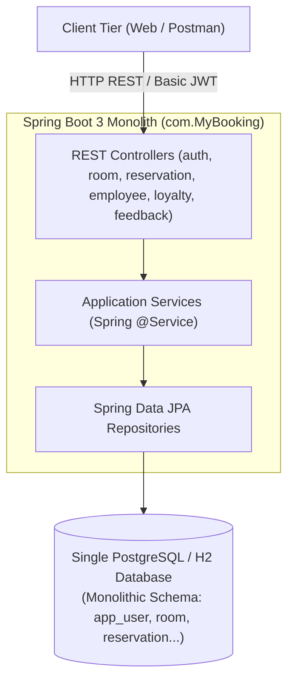

# High-Level Architecture Specification: Baseline Monolith to Target Enterprise Platform

## 1. Executive Summary & Transformation Mission

The **Overlook Platform** (*MyBooking*) is undergoing a comprehensive architectural transformation, evolving from an initial academic/prototype single-hotel management monolith into an **enterprise-grade, multi-property, distributed hospitality and resort operating system**.

### The Core Mission
Modern hospitality enterprises operate 24/7 across multiple geographic properties, requiring:
1. **Sub-second availability search and dynamic yield pricing** to maximize revenue per available room (RevPAR).
2. **Zero double-booking guarantees** under peak concurrency.
3. **Seamless guest and staff digital experiences** (responsive web guest booking + low-latency native staff desktop workstations).
4. **Physical automation** through IoT-connected smart rooms and autonomous robotics for housekeeping and delivery.
5. **Zero-Trust security** where every request and inter-service call is cryptographically authenticated.

This document serves as the high-level architectural bridge between our **Point of Departure** (the current v1 monolith) and our **Target Architecture** (the 13-microservice polyglot platform).

---

## 2. Point of Departure: The Current Overlook Monolith (v1.0)

### 2.1 Architectural Characteristics
The existing platform was built as a classic 3-tier Spring Boot application backed by a single relational database:



### 2.2 Functional Scope of v1.0
- **Rooms & Facilities**: Basic CRUD for rooms (`SINGLE`, `DOUBLE`, `DELUXE`, `FAMILY`), static room prices, static room status (`AVAILABLE`, `OCCUPIED`, `OUT_OF_SERVICE`), and simple equipment associations.
- **Reservations**: Basic booking creation, date-range check, check-in, check-out, and cancellation.
- **Staff Operations**: Basic employee profiles, manual task assignments, shifts, and leave requests.
- **Loyalty**: Basic points accumulation and redemption.
- **Feedback & Announcements**: Post-stay feedback reviews, staff replies, and general hotel announcements.

### 2.3 Identified Technical Debt & Architectural Bottlenecks
Through our comprehensive audits, the following fundamental limitations were identified in the v1 baseline:

| Architectural Area | Current Monolith (v1.0) State | Engineering Bottleneck / Risk |
| :--- | :--- | :--- |
| **Multi-Tenancy** | Single property only. Entities lack `property_id` or tenant partitioning. | Cannot support hotel chains, franchises, or multi-property management. |
| **Concurrency & Double-Booking** | No database row locks or distributed locks. In-memory check followed by insert. | Severe race conditions during flash sales; multiple guests can book the same room for the same dates. |
| **Pricing Engine** | Static `price numeric(12,2)` column on the `room` table. | Inability to adjust rates based on demand, occupancy, seasonality, or competitor pricing. |
| **Security & Identity** | Client-supplied `X-User-Id` headers; weak JWT secret default; missing `userId` in token claims. | Insecure Direct Object Reference (IDOR); excessive database lookups to resolve user identity. |
| **Domain Coupling** | Anemic domain models with business logic scattered across controllers and services; cross-domain SQL joins. | Code modification in one domain (e.g. employee) risks breaking unrelated domains (e.g. reservation). |
| **Availability Search** | Synchronous full-table database scans and filtering on relational tables. | High database CPU usage and slow response times under high web traffic. |
| **Physical Operations** | Manual task dispatch; zero sensor integration; zero automated equipment. | High operational cost; no smart room locks, HVAC controls, or robotic automation. |

---

## 3. The Future Architecture: Enterprise Overlook Platform (v2.0)

### 3.1 Architectural Philosophy & Strategy
The transition follows an **Evolutionary Modular Monolith to Polyglot Microservices** strategy:
1. **Phase 1 to Phase 5**: Modernize, stabilize, and logically isolate domains within a clean **Modular Monolith** with strict bounded contexts and logical PostgreSQL schema isolation.
2. **Phase 6 to Phase 15**: Systematically extract high-performance and physical edge services into specialized polyglot runtimes (C++20, Go, Rust, ROS 2) while maintaining the transactional core in Java 17 / Spring Boot 3.

### 3.2 High-Level C4 Container Topology (The 13 Services)

```mermaid
graph TD
    subgraph Client Applications Tier
        WebGuest["Next.js 14 Web App<br/>(Guest Booking & Loyalty Portal)"]
        TauriDesk["Rust + Tauri Desktop App<br/>(Front-Desk, Housekeeping & Workstations)"]
    end

    subgraph Ingress Tier [Service 1]
        APIGateway["1. edge-api-gateway (Go)<br/>TLS Termination, Rate Limiting, Token Relay"]
    end

    subgraph Core Transactional Business Tier [Services 2-8]
        IdentitySvc["2. identity-service (Java)<br/>OAuth2/OIDC, Zero-Trust RBAC"]
        InventorySvc["3. inventory-service (Java)<br/>Multi-Property Catalog & Rooms"]
        ReservationSvc["4. reservation-service (Java)<br/>Booking Engine & Distributed Locks"]
        LoyaltySvc["5. loyalty-service (Java)<br/>Points Ledger & Tier Rules"]
        HousekeepingSvc["6. housekeeping-service (Java)<br/>Room Rack State Machine & Staff Dispatch"]
        PaymentSvc["7. payment-service (Java)<br/>Folios & External Payment Adapters"]
        NotificationSvc["8. notification-service (Java)<br/>Multi-Channel Comms (SMS, Email, Push)"]
    end

    subgraph Specialized High-Performance Engines [Services 9-11]
        PricingEngine["9. pricing-engine (C++20)<br/>Dynamic Yield Matrix Solver (gRPC)"]
        SearchEngine["10. availability-search (Go)<br/>High-Concurrency In-Memory Search (Redis)"]
        AnalyticsSvc["11. analytics-service (Go)<br/>OLAP Engine & Revenue Analytics (ClickHouse)"]
    end

    subgraph Physical Automation & AI Tier [Services 12-13]
        AIGateway["12. ai-agent-gateway (Python)<br/>Sandboxed RAG & Deterministic Policy Guard"]
        IoTFleet["13. iot-robot-fleet-gateway (Rust / ROS 2)<br/>Smart Room Telemetry & Autonomous Robot Fleet"]
    end

    subgraph Event & Persistence Infrastructure
        Kafka[("Event Streaming Bus<br/>Kafka / Redpanda")]
        PostgresDB[("Core Relational DBs<br/>PostgreSQL (Isolated Schemas)")]
        RedisCache[("Cache & Locks<br/>Redis Cluster")]
        ClickHouseDB[("OLAP Analytics<br/>ClickHouse")]
        TimescaleDB[("Time-Series Telemetry<br/>TimescaleDB")]
    end

    WebGuest --> APIGateway
    TauriDesk --> APIGateway
    APIGateway --> CoreBusiness
    APIGateway --> HighPerf

    CoreBusiness --> Kafka
    HighPerf --> Kafka
    PhysicalAutomation --> Kafka

    CoreBusiness --> PostgresDB
    ReservationSvc --> RedisCache
    SearchEngine --> RedisCache
    AnalyticsSvc --> ClickHouseDB
    IoTFleet --> TimescaleDB
```



---

## 4. Key Target Functionalities & Innovation Pillars

### 4.1 Multi-Property Resort Hierarchy
- **Property Abstraction**: Universal `property_id` scoping across all rooms, staff, rates, and bookings.
- **Enterprise Central Reservation System (CRS)**: Allows guests to search across multiple hotel locations, compare property amenities, and manage aggregated loyalty accounts.

### 4.2 Dynamic Pricing & Yield Management Engine (C++20 / gRPC)
- Replaces static rates with a high-speed matrix optimization engine calculating prices in real-time based on:
  - Current property occupancy percentage.
  - Historical booking pace (velocity).
  - Seasonal calendars, holiday spikes, and local events.
  - Competitor price feeds.
- Sub-millisecond pricing calculations served via binary gRPC protocols directly to the availability search engine.

### 4.3 High-Concurrency Availability Engine & Zero Double-Booking Guarantee
- **Read Path**: High-throughput room search queries are offloaded from PostgreSQL to an in-memory Redis search read model (Go-based `availability-search`).
- **Write Path**: Multi-tiered concurrency protection:
  1. *Tier 1*: Distributed Redis lock (`lock:room:{propertyId}:{roomId}:{dates}`) prevents concurrent booking attempts.
  2. *Tier 2*: Database row-level pessimistic locking (`SELECT ... FOR UPDATE`) guarantees transactional isolation.
  3. *Tier 3*: Database unique exclusion constraints prevent physical overlapping date ranges.

### 4.4 Automated Housekeeping & Smart Room Operations
- **Housekeeping State Machine**: Dynamic room status transitions (`DIRTY` -> `CLEANING_DISPATCHED` -> `CLEANED` -> `INSPECTED` -> `READY_FOR_CHECKIN`).
- **Staff Workstation App (Rust + Tauri)**: Fast, memory-efficient native desktop workstation for front-desk staff with physical hardware integrations (keycard encoders, passport scanners, receipt printers).
- **Physical Room IoT & Robotics**:
  - Digital room keys via Bluetooth Low Energy (BLE) and smart door locks.
  - Occupancy and HVAC sensors delivering real-time energy savings.
  - Autonomous robot vacuum fleet and room service delivery rovers integrated via ROS 2 (Robot Operating System).

### 4.5 Sandboxed AI Concierge & Operational Intelligence
- Guest-facing AI concierge delivering personalized dining, activity, and stay recommendations via Retrieval-Augmented Generation (RAG).
- **Deterministic Policy Guard**: AI agents have **zero direct database access**. All actions (e.g. late check-out requests, room upgrades) are validated through strictly typed, authorized gRPC Tool APIs with mandatory human-in-the-loop approvals for sensitive operations.

---

## 5. Architectural Comparison: Baseline (v1.0) vs. Target (v2.0)

| Dimension | Point of Departure (v1.0 Monolith) | Target Enterprise Platform (v2.0) |
| :--- | :--- | :--- |
| **System Architecture** | Single Monolithic Spring Boot App | 13 Polyglot Microservices + Event-Driven Core |
| **Language & Runtimes** | Java 17 only | Java 17, Go (Gateway/Search), C++20 (Pricing), Rust (IoT/Desktop), Python (AI) |
| **Client Interfaces** | Generic Web UI & Postman collection | Next.js 14 Guest Web App + Rust/Tauri Staff Desktop Workstation |
| **Database Architecture** | Single shared database for all tables | Database-per-Service: PostgreSQL, Redis, ClickHouse, TimescaleDB |
| **Inter-Service Comms** | In-memory synchronous method calls | Asynchronous Kafka Events + Synchronous Internal gRPC / mTLS |
| **Security Model** | Insecure `X-User-Id` headers; shared secret | Zero-Trust: Asymmetric JWT, `@AuthenticationPrincipal UserPrincipal`, SPIFFE/SPIRE mTLS |
| **Pricing Model** | Static base price per room type | Real-time Dynamic Yield Optimization Engine (C++20) |
| **Double-Booking Guard** | In-memory verification (prone to race conditions) | Redlock Distributed Locking + DB Row Locks + Exclusion Constraints |
| **Hardware & IoT** | None | Smart door locks, HVAC telemetry (Rust) & ROS 2 Robot Fleet |
| **Analytics & Reporting** | Synchronous relational aggregation queries | Real-time OLAP ClickHouse engine + Go Analytics Service |

---

## 6. Incremental Evolution & Roadmap Alignment

The transformation is structured across **15 distinct phases** to ensure continuous delivery, stability, and zero production downtime:

```
┌─────────────────────────────────────────────────────────────────────────────┐
│ FOUNDATION: Modular Monolith Remediation & Security (Phases 01 - 05)         │
│ • Phase 01: Repository Consolidation & Test Harness Repair (COMPLETED)      │
│ • Phase 02: Zero-Trust Security & UserPrincipal Identity (CURRENT)          │
│ • Phase 03: Domain Refactoring & Reservation Core Fixes                     │
│ • Milestone IdP: Keycloak Identity Provider Adoption & Next.js BFF          │
│ • Phase 04: Modular Monolith Bounded Contexts & Schema Isolation            │
│ • Phase 05: Transactional Outbox & In-Memory Domain Events                  │
└──────────────────────────────────────┬──────────────────────────────────────┘
                                       │
                                       ▼
┌─────────────────────────────────────────────────────────────────────────────┐
│ HIGH-PERFORMANCE POLYGLOT ENGINES (Phases 06 - 08)                          │
│ • Phase 06: C++20 Dynamic Pricing Engine & gRPC Interface                   │
│ • Phase 07: Go Availability Search & Redis Read Model                       │
│ • Phase 08: Identity Domain Service Extraction & SPIFFE/SPIRE Workload mTLS │
└──────────────────────────────────────┬──────────────────────────────────────┘
                                       │
                                       ▼
┌─────────────────────────────────────────────────────────────────────────────┐
│ EVENT-DRIVEN SCALE & DISTRIBUTED DATA (Phases 09 - 10)                      │
│ • Phase 09: Kafka Event Streaming & Distributed Saga Orchestration          │
│ • Phase 10: Full Database-per-Service Migration & ClickHouse OLAP           │
└──────────────────────────────────────┬──────────────────────────────────────┘
                                       │
                                       ▼
┌─────────────────────────────────────────────────────────────────────────────┐
│ HARDWARE, ROBOTICS, AI & DESKTOP WORKSTATIONS (Phases 11 - 15)              │
│ • Phase 11: Sandboxed AI Agent Platform & Policy Guard Layer                │
│ • Phase 12: Rust IoT Edge Gateway & Smart Room Telemetry                    │
│ • Phase 13: ROS 2 Autonomous Robot & Drone Fleet Management                 │
│ • Phase 14: Rust + Tauri Native Staff Workstation Desktop App               │
│ • Phase 15: Kubernetes DevSecOps Production Deployment & Observability      │
└─────────────────────────────────────────────────────────────────────────────┘
```

---

## 7. Data Modeling Governance (Merise & DDD)

In accordance with our governance rules:
1. The **v1.0 Merise artifacts** in [`modelisation/`](../../modelisation/README.md) remain the historical record of the single-hotel starting point.
2. At **Phase 04**, when logical database schemas are split via Flyway, updated Merise MCD and MPD models will be formally produced for each domain bounded context (`auth`, `inventory`, `booking`, `loyalty`, `operations`).
3. In **Phases 06–13**, dedicated data models will be authored for each extracted service (relational, time-series, columnar, and in-memory).
