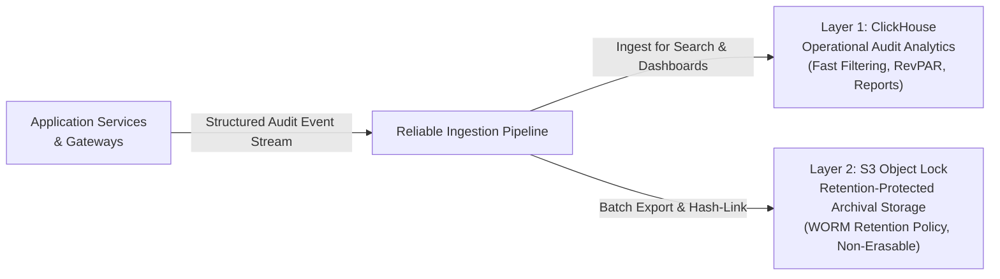
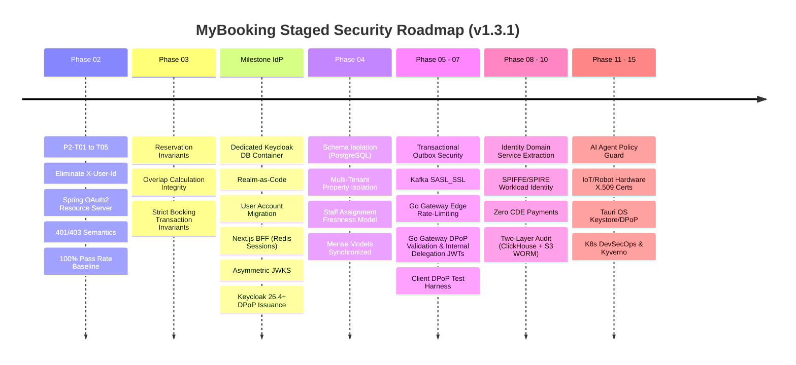

# MyBooking Security Engineering & Architecture Standard

- **Document ID**: `SEC-STD-001`
- **Version**: `1.3.1-draft`
- **Status**: `Draft — Pending Final Review`
- **Owner**: Security Architecture & Platform Engineering Team
- **Effective / Review Date**: 2026-11-01
- **Target Verification Baseline**: OWASP ASVS v5.0.0 Level 2 (Applicability-Scoped), OWASP API Security Top 10 (2023), GDPR, PCI DSS v4.0.1 (SAQ A Eligibility Target)

---

## Document Governance & Classification Standard

This document establishes the binding security vision, engineering principles, normative requirements, and architectural boundaries across all bounded contexts, microservices, and client tiers of the MyBooking platform.

### Architectural Governance Categories
To ensure architectural integrity and prevent ambiguity, all technical assertions throughout this document are classified into four distinct governance categories:
1. **[Requirement]**: A normative engineering obligation (using RFC 2119 keywords: **MUST**, **MUST NOT**, **SHOULD**, **SHOULD NOT**, **MAY**).
2. **[Approved Decision]**: An architectural baseline formally evaluated and accepted in an Architecture Decision Record (ADR).
3. **[Implementation Pattern]**: A sanctioned code-level or design pattern that satisfies a requirement or approved decision.
4. **[Candidate / Under Evaluation]**: A prospective technology, tool, or protocol undergoing architectural evaluation that requires a dedicated ADR prior to production adoption.

### Verification & Traceability Status Taxonomy
Claims of security control maturity throughout this document, specifications, and requirements matrices **MUST** adhere strictly to the following 5-tier taxonomy:
1. **Target**: A required future security outcome. The architecture control is defined and assigned to a roadmap milestone, but design specifications and implementation have not commenced.
2. **Designed**: The architectural specification, interface contract, and verification plan are fully documented in approved ADRs and specifications, ready for implementation.
3. **Implemented**: Code or infrastructure exists in the codebase, but automated verification evidence or compliance audit is incomplete or pending execution.
4. **Verified**: The control is implemented and actively validated by automated tests (unit, integration, slice), CI/CD quality gates, static analysis, or container vulnerability scans, with reproducible evidence.
5. **Accepted Risk**: An explicitly approved deviation or temporary compensating control with a documented business justification, risk owner, and mandatory expiration/review date.

### Document Change History
| Version | Date | Author / Role | Summary of Changes |
| :--- | :--- | :--- | :--- |
| **1.0.0** | 2026-10-31 | Platform Architecture | Initial baseline security standard drafting. |
| **1.1.0-draft**| 2026-11-01 | Senior Security Architect | Comprehensive revision pass: corrected `UserPrincipal` identity mapping; eliminated stale JWT tenant claims; updated Problem Details to RFC 9457; refined GDPR anonymization vs. pseudonymization; established true transaction-based concurrency baselines; rebuilt ASVS 5.0 mapping with `v5.0.0-<id>` catalogue; classified infrastructure candidates; updated document governance. |
| **1.2.0-draft**| 2026-11-01 | Senior Security Architect | Architectural revision pass (v1.2.0): incorporated hybrid authorization freshness for staff property assignments (Q1); adopted Redis-backed distributed BFF session management with `SameSite=Lax` and concurrency handling (Q2); mandated dedicated PostgreSQL container for Keycloak (Q3); established two-layer audit architecture with ClickHouse operational analytics and S3 Object Lock WORM archival (Q4); brought DPoP (RFC 9449) forward with explicit Gateway validation and downstream delegation (Q5); decoupled `UserPrincipal` from `UserDetails` password abstractions; clarified local JWKS verification vs. IdP availability; corrected opaque `(iss, sub)` mapping; distinguished storage, database, and application field encryption; refined GDPR erasure and PCI DSS SAQ A eligibility. |
| **1.3.0-draft**| 2026-11-01 | Senior Security Architect | Finalization pass (v1.3.0): codified ADR-0004 BFF session envelope encryption (KEK/DEK) and key-provider abstraction; codified ADR-0019 Gateway-signed asymmetric internal delegation JWTs (`iss, sub, aud, act, exp, iat, jti`); codified ADR-0020 S3 Object Lock Governance vs. Compliance modes and corrected WORM evidentiary/non-repudiation terminology; pinned Keycloak 26.4+ for DPoP support; finalized DPoP implementation sequencing (client test harness in Phase 7, Tauri OS keystore in Phase 14); established Phase 2 implementation-readiness baseline. |
| **1.3.1-draft**| 2026-11-01 | Principal Security Architect | Targeted corrective revision (v1.3.1): reconciled password hashing policy to authoritative Keycloak ownership (PBKDF2-SHA512 default/FIPS, Argon2id configurable) eliminating conflicting application-level requirements (SEC-FINDING-01); specified distributed multi-replica DPoP replay protection in Redis with atomic SETNX, key derivation, fail-closed behavior, canonical URI validation via trusted proxy configuration, and RFC 9449 §4.3 query/fragment exclusion (SEC-FINDING-02); fully defined normative Gateway internal delegation JWT profile (`typ`, `alg`, `kid`, `iss`, `sub`, `aud`, `iat`, `exp`, `jti`, `act`, `user_id`, clock skew, JWKS key rotation, and mTLS boundary) (SEC-FINDING-03); clarified interplay between GDPR erasure and immutable audit retention, data minimization, IP/User-Agent classification, and legal hold controls (SEC-FINDING-04); detailed technical WORM/Object Lock boundaries, hash chains, Merkle trees, manifest signatures, missing upload alerting, Governance vs Compliance staging, and MinIO vs cloud guarantees (SEC-FINDING-05); defined session encryption key lifecycle (`SessionEncryptionKeyProvider`, KEK/DEK rotation without mass logout, key retirement) (SEC-FINDING-06); established 5-tier status taxonomy (Target, Designed, Implemented, Verified, Accepted Risk) and downgraded unsubstantiated claims (SEC-FINDING-07). |

---

## 1. Security Vision & Core Principles

The MyBooking platform manages mission-critical hotel operations spanning guest reservations, staff administration, dynamic pricing, room automation, and autonomous robotics. Security is not an externalized product feature or an afterthought; it is a fundamental system property woven into every service contract and deployment topology.

### 1.1 Enterprise-Grade Security Objectives
1. **Confidentiality**: Protect guest Personally Identifiable Information (PII), employee data, financial records, and operational telemetry against unauthorized inspection or exfiltration across multi-tenant boundaries.
2. **Integrity**: Guarantee that room availability, dynamic pricing, reservations, payments, and hardware actuation commands are tamper-proof and cryptographically verified.
3. **Availability & Resilience**: Prevent denial-of-service, algorithmic complexity attacks, and distributed resource exhaustion using rate limiting, backpressure, bulkheads, and circuit breakers.
4. **Auditability, Accountability and Evidence Integrity**: Ensure every identity lifecycle event, financial transaction, room status mutation, and physical device actuation produces an accountable, tamper-resistant audit event supporting verifiable evidence integrity and forensic investigation.

### 1.2 Foundational Engineering Principles

```
┌────────────────────────────────────────────────────────────────────────┐
│                   Zero Trust Architecture (NIST SP 800-207)            │
│  "Never Trust, Always Verify" — Cryptographic Identity on Every Hop   │
├───────────────────┬───────────────────┬────────────────────────────────┤
│  Least Privilege  │ Defense in Depth  │   Secure by Default & Design   │
├───────────────────┼───────────────────┼────────────────────────────────┤
│ Fail-Closed Logic │Duty Separation(SoD│    Explicit Trust Boundaries   │
└───────────────────┴───────────────────┴────────────────────────────────┘
```

1. **Zero Trust Architecture (ZTA) [Requirement]**: Network locality implies zero trust. Private VPCs or internal subnets do not grant implicit authorization. Every request—ingress from internet clients or lateral service-to-service calls—**MUST** present verifiable cryptographic identity and explicit authorization.
2. **Principle of Least Privilege (PoLP) [Requirement]**: Every user, service, background worker, AI agent, and IoT actuator **MUST** operate with the minimal set of permissions required to execute its immediate task. Privilege elevation **MUST** be ephemeral, audited, and context-bound.
3. **Defense in Depth [Requirement]**: Security controls **MUST** operate across multiple independent layers: client input validation, edge gateway rate-limiting, WAF inspection, JWT signature verification, Spring Security method-level authorization (`@PreAuthorize`), domain aggregate invariants, repository tenant filters, and network-level mTLS.
4. **Secure by Default & Secure by Design [Requirement]**: Endpoints **MUST** be private and unauthenticated by default. Missing configuration, missing identity claims, or unrecognized tokens **MUST** default to rejection.
5. **Fail-Closed Behavior [Requirement]**: When an authorization decision cannot safely be obtained due to dependency failure (e.g. database down, authorization cache partition, or unverified permissions), the system **MUST** deny access immediately (`401 Unauthorized` or `403 Forbidden`). It **MUST NEVER** fail open. *Note: Local verification of an already-issued, unexpired JWT using securely cached JWKS public keys remains operational even if the Identity Provider is temporarily unreachable; see Section 2.5.*
6. **Separation of Duties (SoD) [Requirement]**: Architectural boundaries **MUST** prevent single entities from possessing unchecked control. Identity providers handle authentication but never own business logic; employees cannot approve their own leave requests; AI agents cannot execute financial refunds or physical lock overrides without human-in-the-loop authorization.
7. **Explicit Trust Boundaries [Requirement]**: Trust boundaries **MUST** be formally recognized and enforced between:
   - External untrusted clients (browsers, mobile, desktop) and Edge Ingress.
   - Edge Ingress (Gateway) and internal microservices.
   - Internal microservices across bounded contexts.
   - Microservices and database persistence tiers.
   - Software services and physical hardware / IoT actuators.

---

## 2. Identity & Authentication Architecture

Authentication establishes and verifies *who* is acting. MyBooking enforces a strict separation between external authentication infrastructure and application-owned business identity.

```mermaid
flowchart TD
    subgraph ExternalClients["Clients (Untrusted Tier)"]
        Browser["Next.js Guest Portal<br/>(Browser DOM)"]
        Tauri["Staff Workstation<br/>(Rust + Tauri Desktop)"]
        IoT["IoT Gateways / Robots<br/>(Hardware Actuators)"]
    end

    subgraph EdgeTier["Edge & Identity Tier"]
        KC["Keycloak IdP<br/>(OAuth2 / OIDC Authority)<br/>[Approved ADR-0016]"]
        KC_DB[("Keycloak Dedicated DB<br/>(Isolated PostgreSQL Container)<br/>[Approved Decision]")]
        BFF["Next.js BFF Server<br/>(Session Controller)"]
        BFF_Redis[("Shared Redis Session Store<br/>(Tokens, TTL, Concurrency Lock)<br/>[Approved Decision]")]
        EdgeGW["Edge API Gateway<br/>(JWKS Local Verification, DPoP Validation)<br/>[Proposed ADR-0008, ADR-0019]"]
    end

    subgraph ServiceTier["Backend Domain Services (Resource Servers)"]
        Monolith["Spring Boot Monolith / Microservices<br/>(NimbusJwtDecoder, Decoupled Principal)<br/>[Approved ADR-0003]"]
        IdentitySvc["Identity Domain Service<br/>(Profiles, Tenant Assignments)"]
    end

    Browser <-->|Opaque Session Cookie + Anti-CSRF| BFF
    BFF <-->|Redis Session Read/Write| BFF_Redis
    BFF <-->|Auth Code + PKCE| KC
    BFF -->|Bearer JWT| EdgeGW
    Tauri <-->|Auth Code + PKCE (DPoP Bound)| KC
    Tauri -->|DPoP Bound JWT + DPoP Proof| EdgeGW
    IoT <-->|mTLS / X.509 Device Cert| EdgeGW
    EdgeGW -->|Verified Internal Token| Monolith
    Monolith <-->|Domain Profiles & Fresh Tenant Context| IdentitySvc
    KC <-->|Private Network Only| KC_DB
    KC -.->|JWKS Public Key Distribution| EdgeGW
    KC -.->|JWKS Public Key Distribution| Monolith
```

### 2.1 Centralized Identity Provider (Keycloak)
- **Authority [Approved Decision - ADR-0016]**: Keycloak is adopted as the centralized Identity Provider (IdP) and OAuth2/OIDC authorization server.
- **Authoritative Credential Ownership & Password Policy [Requirement - SEC-FINDING-01]**:
  - **Exclusive IdP Responsibility**: Keycloak owns user credential management, password storage, authentication verification, and credential lifecycle exclusively. MyBooking backend domain services, microservices, and databases **MUST NOT** store, hash, or independently validate user passwords. No password tables, custom hashers, or password-checking logic exist in application code.
  - **Authoritative Keycloak Password Hashing Baseline**:
    - **PBKDF2 with HMAC-SHA512** (Keycloak 26.x default and FIPS 140-2 compliant algorithm, configured with minimum 210,000 iterations per OWASP recommendations) serves as the baseline default password hasher in Keycloak.
    - **Argon2id** (RFC 9106) is the approved alternative where supported and configured via Keycloak realm password policy providers for high-security non-FIPS deployments.
    - Legacy PBKDF2-HMAC-SHA256 remains a supported configurable option in Keycloak for backward compatibility, but is not the platform baseline.
    - Password hashing algorithm configuration and verification are enforced declaratively via Keycloak realm-as-code configuration (`mybooking-platform` realm) and tested during Keycloak deployment verification, rather than implemented in application services.
  - **Credential Migration Policy**: User account migration to Keycloak **MUST** enforce an immediate forced password reset (`UPDATE_PASSWORD` required action). Legacy password hashes are **NEVER** imported, re-hashed, or handled by MyBooking backend code; users establish new credentials directly against Keycloak under its authoritative policy.
  - Password complexity policies, breached-credential checks, and brute-force lockout are configured and enforced natively within Keycloak.
  - Multi-Factor Authentication (MFA) via TOTP (RFC 6238) and FIDO2 / WebAuthn passkeys.
  - User session lifecycle, single sign-on (SSO), and single sign-out propagation.
  - OpenID Connect discovery (`/.well-known/openid-configuration`) and JWKS endpoint (`/protocol/openid-connect/certs`).
  - Asymmetric token issuance (RS256 / ES256).
  - Officially supported DPoP-bound token issuance and confirmation claim (`cnf.jkt`) binding (RFC 9449).
- **Keycloak Dedicated Database Topology [Approved Decision]**:
  - Keycloak **MUST** deploy with a dedicated PostgreSQL database container, isolated from MyBooking application databases.
  - The deployment **MUST** utilize a dedicated database name, dedicated database user, independent credentials/secrets, and a dedicated persistent storage volume.
  - Database access **MUST** be restricted to private container-network access with zero public exposure.
  - Backup and restore procedures **MUST** operate independently from application database lifecycles.
  - The deployment configuration **MUST** pin an exact tested patch version of Keycloak (with a minimum supported baseline of **Keycloak 26.4.x** for officially supported DPoP implementation [ADR-0016]) and a compatible PostgreSQL release.
  - *Operational Trade-off*: A dedicated container and persistent volume establish clear operational isolation. In development/hobby environments, a single container is an accepted single point of failure (SPoF); production high availability (HA clustering, multi-AZ replication) will be governed by Kubernetes deployment specifications (Phase 15).
- **Realm Architecture [Approved Decision - ADR-0016]**: MyBooking **MUST** utilize a single unified platform realm (`mybooking-platform`). Tenant multi-tenancy is modeled within the application domain. Keycloak Organizations **MAY** be evaluated for administrative delegation, but **MUST NOT** replace application-owned tenant authorization.

### 2.2 Client Authentication Flows
| Client Tier | Flow / Mechanism | Transport Security | Credential & Token Handling |
| :--- | :--- | :--- | :--- |
| **Guest Web Portal (Next.js)** | Authorization Code Flow with PKCE via Backend-for-Frontend (BFF) | HTTPS (TLS 1.3) | Tokens **MUST NEVER** reach browser DOM (`localStorage`/`sessionStorage`). Browser receives an opaque, high-entropy session ID cookie (`HttpOnly`, `Secure`, `SameSite=Lax`). Session and tokens are managed server-side in Redis. BFF presents standard Bearer tokens or receives Gateway delegation tokens for backend calls. |
| **Staff Desktop (Rust + Tauri)** | Authorization Code with PKCE + OS Credential Manager + DPoP (RFC 9449) | HTTPS (TLS 1.3) + DPoP Proofs | Client-associated private key protected by the OS-native keystore. All requests (including `GET`) carrying DPoP-bound tokens **MUST** use the `Authorization: DPoP <token>` scheme accompanied by a unique `DPoP: <proof>` header. Silent downgrade to `Bearer` is strictly rejected. |
| **Internal Microservices** | Client Credentials Grant (RFC 6749) / SPIFFE mTLS SVIDs | TLS 1.3 / mTLS | Initial baseline: Client Credentials with short-lived tokens; Target baseline: SPIFFE/SPIRE X.509 SVIDs (Phases 8/15). |
| **IoT & Robot Hardware** | Mutual TLS (mTLS) with Hardware X.509 Client Certificates | Hardware TLS Engine | Private keys locked in hardware secure element (TPM / ATECC608A). |

### 2.3 Identity Separation: External vs. Internal vs. Authorization Context
A clean distinction **MUST** be maintained across three separate identity layers:
1. **External Identity (IdP)**: Represented by the Keycloak token issuer and subject pair `(iss, sub)` and authentication timestamps. The subject identifier `sub` is an **opaque string** (not assumed to be a UUID).
2. **Internal Application Identity (Domain)**: Represented by the immutable MyBooking user aggregate (`app_user.id: BIGINT`, user profile, registration records). The domain explicitly maps the external pair `(issuer, subject)` to internal `app_user.id` via an indexed mapping table. The system **MUST NEVER** merge or link accounts based on unverified email matching. Email is a mutable contact attribute and **MUST NOT** be treated as an immutable identity key.
3. **Authorization Context (Dynamic)**: Represented by the caller's active role, active property assignment, and shift status. **Mutable hotel assignments, roles, or fine-grained permissions carried in a JWT MUST NOT be treated as authoritative current authorization truth.** Placing volatile tenant assignments into JWT claims creates a security vulnerability where revoked staff permissions persist until token expiration. The JWT conveys identity and coarse baseline roles; tenant assignments and permissions are resolved and validated dynamically via domain services and fresh authorization caches.

### 2.4 Decoupled Application Principal Abstraction
- **Decoupled Contract [Approved Decision - ADR-0003]**: Resource servers **MUST** map validated tokens into an application-owned principal abstraction (`UserPrincipal`).
- **Principal Attributes & Password Decoupling [Requirement]**:
  - The `UserPrincipal` explicitly distinguishes:
    1. *Internal Domain Identity*: `Long id` (`app_user.id`).
    2. *External Identity Metadata*: `(issuer, subject)` pair where required for audit.
    3. *Verified Token Metadata*: Token identifier (`jti`), issued-at (`iat`), expiration (`exp`).
    4. *Coarse Baseline Authorities*: Derived from validated token claims (`ROLE_CLIENT`, `ROLE_EMPLOYEE`, `ROLE_ADMIN`).
  - For OAuth2 Resource Server endpoints, `UserPrincipal` **MUST NOT** implement password-authentication methods (such as Spring Security's `UserDetails.getPassword()`) unless strictly required by legacy harness contracts.
  - In Phase 2, `UserPrincipal` remains an application-owned domain record/class independent of Keycloak-specific token classes or Nimbus library schemas.

### 2.5 Token Validation, Signing & Identity Provider Availability
- **Interim Baseline (Phase 2) [Approved Decision - ADR-0003]**: Spring Boot Resource Server (`NimbusJwtDecoder`) verifies symmetric HS256 tokens using a fail-fast secret (minimum 256 bits, rejecting weak or missing keys at startup).
- **Target Baseline (Milestone IdP) [Approved Decision - ADR-0016]**: Resource servers verify tokens asymmetrically against Keycloak's JWKS endpoint.
- **IdP Availability vs. JWT Validation [Requirement]**: The platform **MUST** distinguish between operations requiring live IdP availability and operations that execute autonomously:
  - *Live IdP Required*: New user login, token refresh, password resets, and session revocation queries require active IdP availability.
  - *Local Autonomous Verification*: Resource servers **MUST** validate already-issued, unexpired JWT signatures locally using cached JWKS public keys. An API request presenting an unexpired, cryptographically valid token **MUST NOT** be rejected merely because the IdP is temporarily unreachable, provided key rotation policies are satisfied.
  - *Fail-Closed Authorization*: If downstream domain authorization dependencies (e.g., tenant assignment database or policy cache) are unreachable, the request **MUST** fail closed.
- **Strict Claims Validation [Requirement]**: Token decoders **MUST** explicitly validate:
  - Header `alg`: Whitelist strictly approved algorithms (`RS256`, `ES256` in target; `HS256` in Phase 2 interim). Reject `none` or algorithm switching.
  - Header `typ`: Whitelist `JWT` (or `at+jwt` where RFC 9068 applies).
  - Claim `iss`: Whitelist exact expected IdP issuer URL.
  - Claim `aud`: Whitelist application resource identifier.
  - Claim `exp`: Enforce expiration strictly with a maximum allowed clock skew of 30 seconds.
  - Claim `nbf` and `iat`: Reject future-dated tokens.

### 2.6 Token Lifecycle, Revocation & Session Invalidation
The standard explicitly distinguishes five separate lifecycle mechanisms:
1. **Keycloak Session Termination**: User logs out or is administratively terminated in Keycloak. Invalidates the user's IdP SSO session and prevents further token refresh.
2. **BFF Session Revocation**: The Next.js BFF destroys the server-side Redis session and invalidates the browser cookie, terminating the client's web access immediately.
3. **Access Token Expiration**: Short access token lifetimes (5 to 15 minutes) guarantee that any already-issued bearer token naturally expires within a short, bounded window.
4. **Token Revocation / Blacklisting**: High-consequence revocations (e.g. reported key compromise) query an invalidation cache or await short-lived token expiration. *Keycloak back-channel logout notifies registered clients to terminate active sessions, but does NOT automatically invalidate already-issued JWTs at resource servers without an active token blacklist or short TTL.*
5. **Domain Authorization Changes**: Staff hotel reassignments are handled via domain events and authorization-cache invalidation, independent of token or session validity (see Section 3.3).

### 2.7 Next.js Backend-for-Frontend (BFF) Redis Session Architecture
- **Distributed Session Store [Approved Decision - ADR-0004]**: The Next.js BFF **MUST** use a shared **Redis** deployment to manage user sessions across clustered BFF replicas. PostgreSQL **MUST NOT** be used as the session store.
- **Session Architecture & Token Protection [Requirement - ADR-0004]**:
  - The browser receives only a cryptographically random, high-entropy opaque session identifier.
  - OAuth2 access tokens, refresh tokens, and IdP session state are stored exclusively server-side in Redis.
  - The BFF enforces both **idle session expiration** (e.g., 30 minutes) and **absolute session expiration** (e.g., 8 hours).
  - Session identifiers **MUST** be rotated upon successful authentication and significant privilege transitions.
- **Session Encryption Key Lifecycle Architecture [Approved Decision - ADR-0004, SEC-FINDING-06]**:
  - Application-level encryption of OAuth2 token and session payloads stored in Redis is a **mandatory baseline requirement (`MUST`)** in production environments.
  - **Key Provider Abstraction (`SessionEncryptionKeyProvider`)**:
    - Application code interacts with a vendor-neutral interface abstraction (`SessionEncryptionKeyProvider`) decoupling encryption operations from secret-storage backends.
    - *Development / Local Test*: `EnvSecretKeyManagementProvider` resolves 256-bit symmetric keys from local environment variables.
    - *Production / Staging*: `KmsSecretKeyManagementProvider` integrates with an external KMS/Vault secret-management service.
  - **Envelope Encryption Mechanics**:
    - A Master Key Encryption Key (KEK) is held securely in the secret management provider.
    - Each stored session payload is encrypted using AES-256-GCM with a distinct 256-bit Data Encryption Key (DEK).
    - Redis stores the encrypted session envelope containing: `key_id` (identifying the active KEK version), wrapped DEK, 12-byte initialization vector (IV), ciphertext, and 16-byte GCM authentication tag.
  - **Zero-Downtime Key Rotation Without Mass Logout**:
    - The key provider supports versioned key identifiers (`key_id`).
    - At any point during a key rotation lifecycle, the provider maintains:
      1. *Active Primary Key*: The latest active KEK version, used for encrypting all newly created or updated sessions.
      2. *Retained Previous Keys*: An ordered set of valid prior KEK versions, maintained strictly in **read-only mode** for decrypting existing unexpired sessions.
    - When a user request arrives, the BFF decrypts the session using the key identified by `key_id`. Upon session touch, mutation, or token refresh, the session is re-encrypted using the *Active Primary Key*. This enables continuous, seamless key rotation without requiring an uncontrolled mass user logout.
  - **Key Retirement & Purge Policy**:
    - Retained previous keys **MUST** remain accessible for the duration of the maximum absolute session lifetime (8 hours) plus a defined operational grace period (e.g., 1 hour).
    - Once the maximum lifetime of sessions encrypted under an older `key_id` has elapsed, that key version is formally retired and permanently purged from the key provider. Any session payload referencing a purged `key_id` fails decryption and is immediately rejected.
  - **Key Separation & Leakage Prevention Invariants**:
    - Master key material (KEK) and plaintext DEKs **MUST NEVER** be stored in Redis alongside encrypted session envelopes.
    - Cryptographic key material **MUST NOT** appear in application logs, error messages, debug output, metrics, or diagnostic dumps.
  - **Fail-Closed Failure Mode**: If Redis is unreachable, if the key provider fails, or if session decryption fails (e.g. invalid auth tag or unknown `key_id`), the BFF **MUST fail closed** by returning HTTP 401/500 and destroying the invalid browser cookie. It **MUST NOT** grant access based on unvalidated or cached local assumptions.
- **Safe Refresh Token Rotation & Concurrency Handling [Requirement]**: Simultaneous requests from the same browser session entering the BFF must not trigger duplicate refresh calls that invalidate refresh tokens prematurely. The BFF **MUST** implement a distributed lock or mutex in Redis during token refresh to coordinate concurrent requests safely.
- **Cookie & Browser Security [Requirement]**:
  - Session cookies **MUST** carry `HttpOnly`, `Secure`, `Path=/`, and an explicit expiration matching the session policy.
  - **SameSite Policy**: `SameSite=Lax` **MUST** be the initial proposed setting to ensure reliable completion of the OIDC authorization-code redirect flow across browser environments. Any transition to `SameSite=Strict` requires comprehensive end-to-end testing of the complete redirect flow.
  - Anti-CSRF protection (Synchronizer Token Pattern or Double Submit Cookie with HMAC) **MUST** protect all state-changing requests (`POST`, `PUT`, `DELETE`, `PATCH`).
  - *Risk Notice*: Adopting a BFF and `HttpOnly` cookies eliminates browser DOM token theft (XSS exfiltration), but **does not eliminate CSRF or XSS execution risks**. Robust CSRF tokens, strict CSP, and output encoding remain mandatory.
- **Separation from Domain Truth [Requirement]**: Redis is exclusively a transient session and token coordination store; it **MUST NOT** be treated as a source of domain authorization truth.

---

## 3. Authorization & Multi-Tenancy Architecture

Authentication proves identity; authorization determines whether that identity is permitted to perform a specific action on a specific resource within an authorized tenant context.

```
       ┌────────────────────────────────────────────────────────────────┐
       │                Three-Tier Authorization Model                   │
       │                   [Approved Decision - ADR-0017]               │
       ├────────────────────────────────┬───────────────────────────────┤
       │ Tier 1: Role-Based (RBAC)      │ Baseline eligibility (STAFF)  │
       │ Tier 2: Relationship (ReBAC)   │ Tenant & Resource Ownership   │
       │ Tier 3: Attribute-Based (ABAC) │ Dynamic context & shift state │
       └────────────────────────────────┴───────────────────────────────┘
```

### 3.1 The Three-Tier Authorization Model
1. **Tier 1 — Role-Based Access Control (RBAC) [Approved Decision - ADR-0017]**: Gatekeeper enforcing functional role eligibility. Enforced via Spring Method Security (`@PreAuthorize("hasRole('EMPLOYEE')")`).
2. **Tier 2 — Relationship-Based Access Control (ReBAC) [Approved Decision - ADR-0017]**: Enforces organizational hierarchy and object ownership:
   - Verifies guest ownership: `reservation.clientId == principal.id`.
   - Verifies staff property assignment: caller is authorized for the property owning the resource.
3. **Tier 3 — Attribute-Based Access Control (ABAC) [Approved Decision - ADR-0017]**: Evaluates dynamic business context: staff shift status, room operational state, geofencing, or time-of-day.

### 3.2 Tenant Ownership per Aggregate & Bounded Context
Multi-tenancy in MyBooking is scoped by hotel property. However, tenant ownership differs across bounded contexts:
- **Property-Scoped Aggregates (Must have `property_id`) [Requirement]**: Physical and operational resources tied directly to a physical hotel **MUST** include an indexed, non-nullable `property_id`:
  - `Room`, `RoomStatusUpdate`, `Installation`, `EmployeeTask`, `Shift`, `MaintenanceBlock`.
- **Context-Bound Tenant Aggregates [Requirement]**:
  - `Reservation`: Belongs to a guest (`client_id`) and books a room tied to a specific `property_id`.
  - `Employee`: Assigned to one or more hotel properties via an explicit domain association table (`employee_property_assignment`).
- **Global / Non-Property Aggregates [Requirement]**: Entities that span the entire platform **MUST NOT** be artificially bound to a `property_id`:
  - `User` (a guest account exists globally across all hotels).
  - `LoyaltyAccount` (guest loyalty points are earned and redeemed platform-wide).
  - System-wide announcements, equipment catalogs, and platform configuration.

### 3.3 Staff Multi-Hotel Assignment Freshness Strategy
- **Authorization vs. Authentication [Approved Decision]**: Reassigning a staff member from Hotel Paris to Hotel London is an authorization mutation, **not** an authentication session termination. The staff member's authenticated session remains valid; their permitted tenant scope changes.
- **Hybrid Freshness Architecture [Requirement]**:
  1. *Authoritative Store*: The domain-owning identity service remains the authoritative source of staff-to-hotel assignments.
  2. *Domain Event Notification*: Any assignment mutation **MUST** publish an `EmployeePropertyAssignmentChanged` domain event.
  3. *Cache Invalidation*: Subscribed services and API gateways **MUST** invalidate relevant authorization caches upon receiving the assignment event.
  4. *Bounded Staleness for Ordinary Reads*: For ordinary property-scoped read queries (e.g. viewing housekeeping task lists), authorization caches **MAY** operate with a bounded fallback staleness window, targeting **no more than 30 seconds**.
  5. *Authoritative Check for Sensitive Mutations*: Sensitive state mutations **MUST** perform an authoritative, strongly consistent authorization check against the domain store prior to commit. Examples include:
     - Financial operations (refunds, folio adjustments).
     - High-consequence reservation modifications.
     - Employee administration and role/permission changes.
     - Physical room door unlocks and master keycard encoding.
  6. *Access Tokens as Defense-in-Depth*: Short-lived access tokens provide defense-in-depth but **MUST NOT** be treated as the primary mechanism for enforcing hotel assignment changes.
  7. *Keycloak Back-Channel Logout*: Reserved for account suspension, employee termination, or compromised credentials, terminating the user's entire authentication session.

### 3.4 Server-Side Tenant Context Validation & Repository Isolation
- **Core Tenant Invariant [Approved Decision - ADR-0017]**: **A valid authenticated token or an `EMPLOYEE` role alone is NEVER sufficient to access arbitrary hotel resources.**
- **Server-Side Context Validation [Requirement]**: When an employee selects an active hotel property in the UI, the backend **MUST** validate server-side that the authenticated employee has an active, valid assignment to that `property_id`. Client-supplied tenant headers (e.g. `X-Property-Id`) are treated as untrusted requests for context and **MUST** be verified against server-side authorization state before executing queries.
- **Tenant-Scoped Repository Queries [Requirement]**: All database queries for property-scoped resources **MUST** include explicit tenant predicates (e.g., `WHERE r.property_id = :activePropertyId`). Mutating operations **MUST** verify entity tenant ownership within the database transaction prior to commit.

### 3.5 Object-Level Authorization & BOLA / IDOR Prevention
- **Elimination of Client Identity Headers [Approved Decision - ADR-0003]**: HTTP headers such as `X-User-Id` supplied by the client are strictly forbidden for authorization decisions.
- **Principal Injection [Requirement]**: Identity **MUST** be resolved strictly from `@AuthenticationPrincipal UserPrincipal principal`.
- Controllers and domain services **MUST** verify that requested resources belong to the authenticated caller or that the caller holds verified tenant administrative authority over that resource.

### 3.6 Policy Decision Points (PDP) & Policy Enforcement Points (PEP)
- **Initial Enforcement Baseline (Phases 2–7) [Approved Decision - ADR-0017]**: Authorization logic is owned and executed natively within Java / Spring Security domain services using strongly typed invariants, custom security evaluators, and repository tenant guards.
- **Future Policy Engine Strategy (Phase 8+) [Candidate - ADR-0017]**: As microservices multiply, externalized Policy Decision Points (PDP) will be evaluated:
  - **OpenFGA (Google Zanzibar model) [Candidate]**: Candidate for relationship-based access control (ReBAC).
  - **Cedar / OPA [Candidate]**: Candidate for low-latency ABAC sidecar evaluation.
  - *Adoption of external policy engines requires a dedicated architectural evaluation and approval gate.*

---

## 4. Application & API Security

Every HTTP, gRPC, and asynchronous endpoint must enforce rigorous defensive engineering.

### 4.1 OWASP API Security Top 10 (2023) Defensive Controls
| Threat Category | Mandatory Architecture & Engineering Defense | Requirement ID |
| :--- | :--- | :--- |
| **API1: BOLA (IDOR)** | Strict `@AuthenticationPrincipal` injection; domain-level tenant and resource ownership verification. Zero client-supplied identity headers. | `SEC-AUTHZ-001` |
| **API2: Broken Authentication** | Keycloak OIDC, RS256 JWKS local validation, PKCE, brute-force protection, mandatory staff MFA. | `SEC-IAM-001` |
| **API3: Broken Object Property Level Auth** | Strict DTO schema binding; MapStruct encapsulation; prohibition of direct JPA entity binding on API contracts. | `SEC-API-001` |
| **API4: Unrestricted Resource Consumption** | Token-bucket rate limiting at ingress; pagination on all collection endpoints (default 20, max 100). | `SEC-API-002` |
| **API5: Broken Function Level Auth** | Method-level `@PreAuthorize` on all mutating endpoints; role hierarchies and administrative path isolation. | `SEC-AUTHZ-002` |
| **API6: Unrestricted Access to Sensitive Flows** | Transaction-based database locking, booking state invariants, idempotency keys, and payment velocity checks. | `SEC-API-003` |
| **API7: Server-Side Request Forgery (SSRF)** | Outbound HTTP requests restricted to strict domain whitelists; internal network ranges (RFC 1918, link-local 169.254.169.254) blocked. | `SEC-API-004` |
| **API8: Security Misconfiguration** | Explicit CORS origin whitelisting; standard security headers; non-root container execution; disabled stack traces. | `SEC-API-005` |
| **API9: Improper Inventory Management** | OpenAPI versioned contracts (`/api/v1/...`); automated deprecation schedules; edge route whitelisting. | `SEC-API-006` |
| **API10: Unsafe Consumption of APIs** | Strict TLS verification on third-party APIs; payload validation and cryptographic signature verification on inbound webhooks. | `SEC-API-007` |

### 4.2 Error Handling & HTTP Status Semantics
- **RFC 9457 Problem Details [Requirement]**: API error responses **MUST** adhere to RFC 9457 (*Problem Details for HTTP APIs*), replacing obsolete RFC 7807 formats. Error payloads **MUST NEVER** leak internal stack traces, SQL syntax, database schema names, or internal IP addresses.
- **HTTP 401 vs. 403 Authentication Semantics [Approved Decision - ADR-0003]**:
  - **Missing Authentication**: When an unauthenticated request attempts to access a protected endpoint, the server **MUST** return **HTTP 401 Unauthorized** with header:
    `WWW-Authenticate: Bearer`
    *(It MUST NOT report `error="invalid_token"` when no token was provided).*
  - **Invalid or Expired Authentication**: When a request presents an invalid, expired, or malformed token, the server **MUST** return **HTTP 401 Unauthorized** with header:
    `WWW-Authenticate: Bearer error="invalid_token", error_description="..."`
  - **Insufficient Authorization**: When an authenticated caller lacks necessary role, tenant authority, or resource ownership, the server **MUST** return **HTTP 403 Forbidden**.

### 4.3 Webhook & Asynchronous Ingress Security
- **Inbound Webhook Verification [Requirement]**: Inbound webhooks (e.g., PSP payment notifications) **MUST**:
  - Verify HMAC-SHA256 signatures over the raw payload using a shared webhook secret.
  - Enforce timestamp freshness checks (rejecting requests older than 5 minutes to prevent replay attacks).
  - Enforce processing idempotency using unique external event IDs.

### 4.4 Booking Concurrency & Business Invariants
- **Database Transaction Foundation [Requirement]**: Booking correctness, zero double-booking, and inventory consistency **MUST** be guaranteed by database transaction invariants (ACID transactions, pessimistic row locks `SELECT ... FOR UPDATE`, or PostgreSQL exclusion constraints). Distributed locks (such as Redlock) **MAY** be utilized as an [Implementation Pattern] to reduce database contention during high-demand bursts, but **MUST NOT** be relied upon as the sole foundation of booking correctness.
- **Idempotency [Requirement]**: State-mutating booking and payment APIs **MUST** support an `Idempotency-Key` HTTP header to prevent duplicate reservations or double-charging caused by network retries.

---

## 5. Distributed Systems Security & DPoP Architecture

As MyBooking evolves from a modular monolith to distributed microservices, network isolation, service identities, and inter-service trust must be governed.

```
       ┌────────────────────────────────────────────────────────┐
       │             Distributed Security Topology              │
       ├────────────────────────────────────────────────────────┤
       │ Ingress: Edge API Gateway (TLS 1.3, DPoP, WAF)         │
       │ Mesh: SPIFFE/SPIRE mTLS Service-to-Service Encryption  │
       │ Event Bus: Kafka SASL_SSL + SCRAM-SHA-512              │
       │ Secrets: HashiCorp Vault / External Secrets Operator   │
       └────────────────────────────────────────────────────────┘
```

### 5.1 Service-to-Service Authentication & Transport Security
- **Initial Baseline (Phases 1–7) [Approved Decision - ADR-0001]**: In the modular monolith and early polyglot service integrations (e.g., C++ pricing engine via gRPC in Phase 6), service communication occurs over TLS with mutual authentication using pre-shared TLS certificates or OAuth2 Client Credentials.
- **Target Workload Identity (Phases 8 & 15) [Approved Roadmap]**: In Kubernetes, service-to-service communication **MUST** transition to Mutual TLS (mTLS) backed by **SPIFFE/SPIRE** workload identities. Each service pod receives an ephemeral X.509 SVID proving its service identity without long-lived static secrets.
- **Transport Auth vs. Service Authorization [Requirement]**: Transport authentication (mTLS) proves *which service* is connecting. It does not grant unrestricted business authority. Service-to-service calls executing on behalf of a user **MUST** propagate the user's authorization context via signed JWTs or down-scoped OAuth2 Token Exchange (RFC 8693) tokens.

### 5.2 Edge API Gateway Security & Local Validation
- **Ingress Enforcement [Proposed ADR-0008]**: The Go Edge API Gateway acts as the public ingress gatekeeper.
- **Gateway Validation Does Not Replace Resource Server Security [Requirement]**: While the Edge Gateway validates JWT signatures and strips untrusted client headers at ingress, backend domain microservices (Resource Servers) **MUST independently verify incoming tokens and enforce object-level authorization**. A gateway check never relieves a downstream service from enforcing its own security boundaries.

### 5.3 DPoP (RFC 9449) Sender-Constrained Architecture & Gateway Delegation [Brought Forward]
DPoP is a core component of the current security architecture and is **not deferred to Phase 14**. It establishes cryptographically sender-constrained access tokens bound to client-held private keys.

```
Desktop / Native Client               Edge API Gateway                 Backend Resource Server
         │                                   │                                    │
         │── Request + DPoP Proof + Token ──>│                                    │
         │   (Authorization: DPoP <token>,   │── 1. Validate DPoP Proof           │
         │    DPoP: <proof_jwt> header;      │      (sig, jti, ath, cnf.jkt,      │
         │    proof bound to client key,     │       htm, canonical trusted htu)  │
         │    trusted target URI, method)    │── 2. Distributed Replay Check      │
         │                                   │      (Redis atomic SETNX with TTL) │
         │                                   │── 3. Strip client DPoP proof       │
         │                                   │── 4. Mint Internal Delegation Token│
         │                                   │      (aud: resource-service,       │
         │                                   │       user context, scoped, jti)   │
         │                                   │── 5. Authenticate Gateway Identity │
         │                                   │      (mTLS / SPIFFE workload SVID) │
         │                                   │───────────────────────────────────>│
         │                                   │                                    │── Validate Gateway JWT & JWKS
         │                                   │                                    │── Enforce Tenant/BOLA
```

1. **Keycloak Responsibilities [Approved Decision - ADR-0016]**:
   - Issues DPoP-bound access tokens embedding the confirmation claim: `cnf.jkt` (SHA-256 thumbprint of the client's public key).
   - Validates DPoP proofs during token issuance and token refresh on its OIDC token endpoints.
   - Pinned to **Keycloak 26.4.x** baseline with officially supported RFC 9449 DPoP capabilities.
2. **Edge API Gateway Validation Responsibilities [Approved Decision - ADR-0019, SEC-FINDING-02]**:
   - **Authorization Scheme & Proof Requirement [RFC 9449 §7.1]**: External clients presenting DPoP-bound access tokens **MUST** supply the HTTP header `Authorization: DPoP <access_token>`. In addition, **every** HTTP request carrying a DPoP-bound token—including read-only `GET` and `HEAD` requests as well as state-mutating requests (`POST`, `PUT`, `PATCH`, `DELETE`)—**MUST** include a unique `DPoP: <proof_jwt>` proof header.
   - When a DPoP-bound token is presented, the Gateway **MUST** validate the client's DPoP proof header:
     - Verify JWS header `typ` is strictly `dpop+jwt`.
     - Verify the signature algorithm is an approved asymmetric algorithm from the allowlist (`RS256`, `ES256`, or `EdDSA`); reject symmetric algorithms (`HS256`) and `none`.
     - Verify cryptographic signature against the public key declared in the DPoP JWS header (`jwk`).
     - Verify that the SHA-256 thumbprint of the public key matches the token's `cnf.jkt` claim.
     - Verify HTTP method (`htm`) matches the incoming request method.
     - **Canonical Request URI Validation & Header Stripping [RFC 9449 §4.3, Requirement]**:
       - The Gateway **MUST** validate the target HTTP URI (`htu`) against the externally visible canonical request URI.
       - *Trusted Reverse Proxy Invariant*: Forwarded headers (`Forwarded`, `X-Forwarded-Proto`, `X-Forwarded-Host`, `X-Forwarded-Port`) **MUST** only be accepted when received from explicitly configured, trusted upstream reverse proxies (e.g. trusted cloud load balancer / ingress CIDRs). Untrusted client-supplied forwarded headers **MUST** be stripped at ingress.
       - *Canonical URI Reconstruction*: The Gateway reconstructs the canonical external URI strictly from trusted proxy configuration (trusted scheme, trusted host/authority, normalized path).
       - *Query String & Fragment Exclusion [RFC 9449 §4.3]*: In strict accordance with RFC 9449 §4.3, the DPoP `htu` claim **MUST NOT** include query strings or fragment identifiers. The Gateway compares `htu` strictly against the canonical URI without query parameters or fragments (`scheme://host[:port]/path`). Proofs including query parameters or fragments in `htu` **MUST** be rejected.
     - Verify timestamp freshness (`iat` within a strict window, e.g. <= 60 seconds).
     - Validate the access-token hash (`ath`) matching the SHA-256 digest of the ASCII access token value (RFC 9449 §4.2).
   - **Distributed Multi-Replica Replay Protection [Requirement - SEC-FINDING-02]**:
     - The Gateway runs in Kubernetes as multiple clustered replicas. Replay detection **MUST** be globally coordinated across all Gateway replicas via the shared **Redis** cluster. Single-instance local in-memory caches are strictly forbidden as the primary replay barrier.
     - **Atomic First-Use Registration**: Every valid DPoP proof **MUST** be registered atomically in Redis in a single atomic command:
       `SET dpop:replay:{cnf.jkt}:{jti} 1 NX EX {ttl}`
       Non-atomic read-then-write sequences (e.g. `GET` followed by `SET`) are strictly prohibited due to race conditions.
     - **Replay Cache Key Derivation**: The key is derived strictly from the client public key thumbprint and proof identifier: `dpop:replay:{cnf.jkt}:{jti}`.
     - **TTL Calculation**: The TTL **MUST** equal the accepted proof freshness window (`iat` max age, 60 seconds) plus the maximum permitted clock skew (30 seconds), totaling **90 seconds**.
     - **Cross-Replica Replay Rejection**: If `SET ... NX` returns nil/false (key already exists), the proof has already been registered and the Gateway **MUST** reject the request with `HTTP 401 Unauthorized` regardless of which replica received the initial or replayed request.
     - **Fail-Closed Failure Mode**: If the Redis replay store is unreachable or experiences network timeouts, the Gateway **MUST fail closed** for DPoP requests, rejecting them with HTTP 503 / 401. A DPoP request **MUST NEVER** be allowed through without verified replay protection.
   - **Explicit Client Authentication Differentiation & Zero Silent Downgrade**:
     - The Next.js BFF maintains server-side sessions in Redis and issues standard bearer requests or uses Gateway internal delegation tokens.
     - Tauri / Desktop clients present DPoP-bound tokens (`Authorization: DPoP <token>` accompanied by unique `DPoP: <proof>`).
     - **Zero Silent Downgrade [Requirement]**: The Gateway **MUST NOT** silently downgrade a DPoP-bound token to ordinary bearer-token semantics. If a DPoP-bound token (containing `cnf.jkt`) is presented without a valid proof or with `Authorization: Bearer`, it **MUST** be rejected with HTTP 401.
3. **Backend Resource Server Trust Boundary & Downstream Delegation [Approved Decision - ADR-0019, SEC-FINDING-03]**:
   - **External vs. Internal Token Differentiation [Requirement]**: External DPoP-bound access tokens (`Authorization: DPoP <token>`) and Gateway internal delegation tokens (`Authorization: Bearer <internal_jwt>`) are **distinct token types with separate issuers, audiences, and lifecycles**. Downstream domain resource servers accept **ONLY** the Gateway-signed internal delegation token, validating its dedicated issuer and audience; they **MUST NOT** accept external Keycloak access tokens directly.
   - **Workload Transport Authentication vs. Token Context [Requirement]**: Gateway-to-backend transport authentication (mTLS / SPIFFE SVID) establishes the **workload identity** of the calling Edge Gateway. The internal delegation JWT carries the **authenticated user identity and authorization context**. Downstream services require both: transport mTLS authenticates the Gateway as a trusted caller, while the internal token authenticates the user on whose behalf the call is made. Transport authentication alone does not convey user authority, and internal tokens alone do not replace transport encryption and mutual workload authentication.
   - **Normative Gateway Internal Delegation JWT Profile [Approved Decision - ADR-0019, SEC-FINDING-03]**:
     To ensure interoperability across Spring Boot (Java), Go, C++, and Rust services, internal delegation tokens **MUST** adhere to the following specification:
     - **JWS Header Profile**:
       - `alg`: Permitted asymmetric algorithm allowlist: `ES256` (ECDSA P-256 with SHA-256, recommended for compact signature size) or `RS256` (RSA 2048-bit with SHA-256). All other algorithms (including symmetric `HS256` and `none`) are strictly rejected.
       - `typ`: Explicitly set to `mybooking-internal+jwt` (distinguishing it unambiguously from external OIDC tokens `JWT` or `at+jwt`). Downstream services reject any token where `typ` is not `mybooking-internal+jwt`.
       - `kid`: Key identifier pointing to the active Gateway signing key in the Gateway's internal JWKS.
     - **JWT Payload Claims Profile**:
       - `iss`: Internal Gateway issuer URI (`https://gateway.mybooking.internal`).
       - `sub`: Authenticated caller identity string (stable internal user ID or `(iss, sub)` identifier).
       - `user_id`: Numeric application user primary key (`Long` / `int64`, matching `app_user.id`).
       - `aud`: Audience array or string, strictly restricted to the specific target service (e.g. `["reservation-service"]`).
       - `act`: Actor claim representing delegation chain per RFC 8693 §4.1: `{"sub": "edge-api-gateway"}`.
       - `roles`: Array of coarse baseline system roles (e.g. `["ROLE_EMPLOYEE"]`, `["ROLE_ADMIN"]`, `["ROLE_GUEST"]`).
       - `scope`: Array or space-delimited string of delegated permission scopes (e.g. `["reservations:read", "reservations:write"]`).
       - `iat`: Numeric timestamp (seconds since epoch) when the Gateway minted the token.
       - `exp`: Short-lived expiration timestamp (30 to 60 seconds maximum).
       - `jti`: Unique token identifier (UUIDv4) for audit correlation and tracking.
     - **Downstream Audience & Lifespan Validation Rules**:
       - Each receiving microservice (e.g. `reservation-service`) **MUST** validate that its exact configured service name is present in the `aud` claim. If `aud` targets another service (e.g. `pricing-service`), the token **MUST** be rejected with HTTP 403 / 401.
       - Clock skew policy: maximum 5 seconds (internal cluster clocks synchronized via NTP).
       - Verification keys: Downstream services fetch public keys from the Gateway's internal JWKS (`https://gateway.mybooking.internal/.well-known/jwks.json`), caching keys with a TTL (e.g., 1 hour) and refreshing on encountering an unknown `kid` (rate-limited).
     - **Downstream Authorization Invariants**:
       - The internal delegation token establishes trusted caller identity and delegation context; it does NOT automatically authorize access to arbitrary domain resources.
       - Coarse role claims (`roles`) alone are NEVER sufficient to access or mutate resources.
       - The receiving resource-owning service remains solely responsible for enforcing object-level authorization (BOLA defense) against `user_id` and tenant isolation against `property_id`.
       - Any tenant or hotel context **MUST** be established through trusted server-side authorization context, never blindly accepted from client-supplied headers or request parameters (`X-Property-Id`).
     - **Transport Boundary (mTLS Workload Identity)**:
       - Internal delegation tokens **MUST ONLY** be accepted across the internal service-to-service mTLS boundary (SPIFFE/SPIRE workload SVID proving the caller is the Edge API Gateway). A token presented over an unauthenticated or untrusted transport connection must be rejected.
     - **Custom Architecture Clarification**:
       - This is a custom Gateway-signed asymmetric delegation token architecture designed for low-latency internal propagation. It is NOT an RFC 8693 token exchange implementation.
4. **DPoP Implementation Sequencing [Approved Roadmap]**:
   - *Milestone IdP*: Keycloak 26.4.x configuration for DPoP-bound token issuance.
   - *Phase 07*: Gateway DPoP proof validation (`htm`, `htu`, `iat`, `jti`, `ath`, `cnf.jkt`), Redis atomic replay protection, internal delegation token minting, and the **client proof-generation library and test harness** developed alongside server validation.
   - *Phase 14*: Tauri desktop workstation integrates client proof generation with OS-backed keystores (Keychain, DPAPI, SecretService).
5. **Mandatory DPoP Security & Negative Tests [Requirement - SEC-FINDING-02]**:
   - Missing DPoP proof on DPoP-bound token (rejected with 401).
   - Invalid proof signature or tampered payload (rejected with 401).
   - Public key thumbprint mismatch against `cnf.jkt` (rejected with 401).
   - Replay of the same proof against two different Gateway replicas (asserting rejection on replica 2).
   - Concurrent submission of the exact same proof to multiple replicas (asserting only one succeeds, other fails via atomic Redis NX).
   - Replay store (Redis) unavailability (asserting Gateway fails closed with HTTP 401/503).
   - Mismatched HTTP method (`htm`) or target URI (`htu`) (rejected with 401).
   - Inclusion of query string or fragment in `htu` (asserting rejection per RFC 9449 §4.3).
   - Spoofed forwarded headers from untrusted IP ranges (asserting canonical URI is built from trusted configuration).
   - Expired proof timestamp (`iat`) or clock-skew boundary violation (e.g. +31s future proof, -31s expired proof rejected).
   - Mismatched access-token hash (`ath`) (rejected with 401).
   - Attempted bearer downgrade on protected endpoints (rejected with 401).

### 5.4 Event-Driven Communication Security
- **Event Bus Encryption & ACLs [Proposed ADR-0006]**: Kafka event streaming (Phases 5 & 9) **MUST** enforce `SASL_SSL` transport encryption with `SCRAM-SHA-512` authentication and topic-level Access Control Lists (ACLs).
- **Outbox Integrity [Proposed ADR-0006]**: The Transactional Outbox pattern guarantees that event messages cannot be emitted without successfully committing the corresponding domain state change in the database.

### 5.5 Database Isolation & Service-Owned Data Architecture
- **Service-Owned Data Invariant [Approved Decision - ADR-0001, ADR-0005]**: Each independently deployable microservice **MUST** own its persistence store and **MUST NOT** access another service's database directly.
- **Evolutionary Reconciliation**:
  - *Phase 04*: Monolith PostgreSQL schema isolation (`auth`, `inventory`, `booking`, `loyalty`, `operations`) with zero cross-schema SQL joins and strict package encapsulation. A shared PostgreSQL server hosting separate, isolated databases in local development/hobby environments preserves this principle without physical infrastructure overhead.
  - *Milestone IdP*: Keycloak deploys with its own dedicated PostgreSQL container and isolated volume, completely separate from application databases.
  - *Phase 10*: Complete physical database-per-service isolation where extracted services operate fully independent database clusters.

---

## 6. Cryptography & Key Management

Cryptographic implementations must adhere strictly to current NIST and BSI standards. Custom cryptographic algorithms or home-grown key derivation functions are strictly forbidden.

### 6.1 Approved Cryptographic Standards
| Purpose | Approved Standard | Prohibited / Deprecated |
| :--- | :--- | :--- |
| **Password Hashing** | Delegated exclusively to Keycloak: PBKDF2 with HMAC-SHA512 (Keycloak baseline default / FIPS 140-2) or Argon2id (configurable realm policy). Zero application-managed password storage. | MD5, SHA-1, plain SHA-256, BCrypt, any application-managed password storage |
| **Symmetric Encryption (Data at Rest)** | AES-256-GCM (authenticated encryption) | AES-ECB, AES-CBC without HMAC, DES, 3DES |
| **Asymmetric Signatures (JWT / mTLS)** | RS256 (RSA >= 2048-bit) or ES256 (ECDSA P-256) | RSA < 2048-bit, `none` algorithm, symmetric algorithms on asymmetric endpoints |
| **HMAC Signatures (Interim Phase 2)** | HMAC-SHA256 with key length >= 256 bits (32 bytes) | Keys < 256 bits, weak predictable passphrases |
| **Transport Layer Security** | TLS 1.3 (fallback to TLS 1.2 with PFS ciphers) | SSLv3, TLS 1.0, TLS 1.1, non-PFS cipher suites |

### 6.2 Distinct Encryption Layers & Threat Protection
The standard distinguishes three separate encryption layers, each addressing distinct threat models:
1. **Storage / Volume Encryption (e.g. LUKS, Cloud EBS Encryption)**: Protects against physical media theft or decommissioned drive exposure. Does **not** protect against database engine compromises, SQL injection, or compromised privileged database users.
2. **Database-Level Encryption / TDE**: Encrypts database files at rest. *Note: Standard open-source PostgreSQL does not provide native Transparent Data Encryption (TDE) without custom extensions or enterprise distributions. Volume-level encryption provides the primary baseline.*
3. **Application-Level Field Encryption**: Protects highly sensitive fields (e.g. passport numbers, national ID numbers) prior to writing to the database using AES-256-GCM. Protects data even in the event of unauthorized direct SQL dumps or database backup exfiltration.

### 6.3 Key Lifecycle, Rotation & Recovery
- **Keycloak Signing Keys [Requirement]**: Asymmetric signing keys in Keycloak **MUST** rotate on a defined schedule (e.g., 90 days). The JWKS endpoint **MUST** publish active and retiring keys with unique `kid` values.
- **Fail-Fast Secret Validation (Phase 2) [Approved Decision - ADR-0003]**: Spring Boot resource servers **MUST** validate HMAC secrets at startup; if missing or < 256 bits, the context **MUST** terminate immediately.
- **Secrets Management [Requirement]**: Zero committed secrets in source control (`RULES.md §2.5`). In development, secrets are supplied via local environment variables. In production, secrets **SHOULD** be managed via dedicated secret stores (HashiCorp Vault or Kubernetes External Secrets Operator) integrated with KMS. *Dedicated secret store infrastructure is a [Candidate] requiring an ADR.*

---

## 7. Client & Device Security

The platform interfaces with web browsers, native desktop workstations, and physical hardware.

### 7.1 Web Client Security (Next.js BFF)
- **Elimination of DOM Storage [Requirement]**: Storing access or refresh tokens in `localStorage` or `sessionStorage` is strictly prohibited due to XSS exposure.
- **Session Security**: Session cookies **MUST** carry `HttpOnly; Secure; SameSite=Lax; Path=/`.
- **Content Security Policy (CSP)**: The BFF **MUST** emit strict CSP headers restricting script sources and disabling inline script execution (`unsafe-inline`).

### 7.2 Staff Desktop Workstation Security (Rust + Tauri - Phase 14)
- **Credential Storage [Approved Decision - ADR-0004]**: Workstation session tokens and client signing keys **MUST** be stored securely in the OS-native credential vault (Windows DPAPI / Credential Manager, macOS Keychain, Linux Secret Service).
- **Sender-Constrained Tokens (DPoP - RFC 9449) [Requirement]**: Workstations generate an installation-associated or client-associated asymmetric keypair protected by the OS-native keystore, with explicit key lifecycle management including rotation and revocation. Every outgoing HTTP request (read and write) carries an `Authorization: DPoP <access_token>` header and a unique `DPoP: <proof_jwt>` proof header signed by the workstation's private key, binding the session cryptographically to the physical workstation.
- **IPC Isolation [Approved Decision - ADR-0004]**: The Tauri webview has zero direct access to native OS sockets or filesystems; all operations execute via strictly typed, authorized Rust IPC commands.

### 7.3 IoT & Physical Hardware Security (Phases 12 & 13)
- **Device Identity [Requirement]**: Smart locks, room sensors, and robotic units **MUST** authenticate using unique X.509 device certificates. Private keys **SHOULD** reside in hardware secure elements (TPM or ATECC608A).
- **Physical Safety vs. Software Authorization [Requirement]**: Software authorization grants permission to issue a hardware command. However, physical safety (robot emergency stop, obstacle proximity halt, fire alarm door release) **MUST** be governed by autonomous, fail-safe hardware mechanisms and real-time safety geofences that override all software dispatch queues.

---

## 8. Data Protection, Privacy & Compliance

### 8.1 GDPR Terminology, Lifecycle & Erasure

1. **PII Classification [Requirement]**:
   - *Public*: Hotel room descriptions, published amenities.
   - *Operational*: Room cleanliness status, maintenance logs.
   - *Confidential (PII)*: Guest names, emails, phone numbers, physical addresses, travel document numbers.
   - *Restricted*: Financial tokens, identity credentials, security audit logs.
2. **Distinction Across GDPR Data States [Requirement]**:
   - **Erasure (Article 17)**: The permanent removal or irreversible overwriting of personal identifiers from all operational systems, caches, search indexes, and read models.
   - **Pseudonymization (Recital 26)**: Replacing identifiers with pseudonyms or cryptographic hashes so data cannot be attributed to a specific data subject without additional information. *Hashing personal data, assigning surrogate identifiers (`actor.id`), or retaining tombstone records containing linkable keys remains legally pseudonymized, not anonymized, because linkability, dictionary attacks, or correlation with auxiliary data remain possible.*
   - **Anonymization**: Irreversible rendering of data such that the data subject is not or no longer identifiable by any means by anyone. A retained record containing an original identifier, synthetic linkable key, or relational foreign key reference is **not** anonymized.
   - **Tombstones & Referential Integrity**: Overwriting profile fields with tombstones (e.g. `[ERASED_GUEST]`) while retaining foreign keys preserves referential integrity in relational tables, but constitutes **pseudonymization**, not full anonymization. Tombstones **MAY** be used only where strictly justified to maintain historical database consistency or statutory accounting links.
   - **Crypto-Shredding Limitations [Requirement]**: If crypto-shredding (deleting the encryption key that protects an encrypted field or mapping table) is used, the platform **MUST NOT** claim that deleting a key automatically achieves legal anonymization. Crypto-shredding renders ciphertext mathematically unrecoverable under current cryptanalysis, but residual metadata, access patterns, or linkable context may still constitute personal data under GDPR.
3. **Audit Data Minimization & Potentially Personal Data [Requirement - SEC-FINDING-04]**:
   - Audit event logging **MUST** strictly practice data minimization: log records must only contain attributes strictly necessary for security monitoring, accountability, and legal compliance.
   - Unnecessary personal details (guest preferences, dietary notes, marketing consent, raw payment parameters) **MUST NEVER** be ingested into audit event streams.
   - **Client IP Addresses & User-Agent Information**: Client IPs and user-agent strings captured in audit logs constitute personal data under GDPR. They **MUST**:
     - Be subjected to data minimization (e.g. subnet truncation or masking for non-security operational telemetry).
     - Be access-restricted strictly to authorized security and forensic personnel.
     - Be segregated from business dashboards and general operational reports.
     - Be governed by explicit, limited retention periods.
4. **Audit Data Categories, Legal Basis & Retention Expiry [Decision Requiring Legal/Compliance Validation]**:
   The platform establishes three distinct audit data categories, each tied to an explicit legal basis:
   - *Category A — Statutory Commercial, Tax & Accounting Records*:
     - Scope: Financial transaction records, folio balances, payment references, VAT invoices.
     - Legal Basis: GDPR Article 6(1)(c) — Compliance with a legal obligation (national commercial and tax codes).
     - Target Retention Period: **7 to 10 years** *(exact statutory schedule requires jurisdiction-specific legal/compliance validation)*.
   - *Category B — Security Access, Identity & Forensic Audit Logs*:
     - Scope: Authentication events, privilege elevations, access denials, security configuration changes.
     - Legal Basis: GDPR Article 6(1)(f) — Legitimate interests (defending systems, detecting intrusion, and forensic investigations) and Article 6(1)(c) where NIS2/regulatory standards apply.
     - Target Retention Period: **1 to 3 years** *(requires formal security compliance review)*.
   - *Category C — Operational System Diagnostics*:
     - Scope: Service health checks, performance metrics, non-security trace spans.
     - Legal Basis: GDPR Article 6(1)(f) — Legitimate interest in operational stability.
     - Target Retention Period: **30 to 90 days**.
   - **Retention Expiry Invariant**: When an applicable retention period expires, data **MUST NOT** be retained indefinitely. Archival object stores **MUST** enforce automated bucket lifecycle rules that permanently delete expired object versions upon retention expiration.
5. **Interplay Between GDPR Article 17 Erasure Requests and Immutable WORM Archival [SEC-FINDING-04]**:
   - **No Blanket Exemption**: Immutable storage (WORM / S3 Object Lock) **does not automatically override GDPR erasure obligations**. An organization cannot defeat data subject rights merely by selecting an immutable storage architecture.
   - **Statutory Exception Assessment**: When an Article 17 erasure request is received:
     - The request is assessed against statutory exceptions under GDPR Article 17(3), specifically Article 17(3)(b) (compliance with a legal obligation requiring processing) and Article 17(3)(e) (establishment, exercise, or defense of legal claims).
     - Non-exempt operational data (guest profile tables, marketing preferences, active sessions, Keycloak identity records) **MUST** be irreversibly deleted.
     - Exempt statutory records (accounting invoices, VAT records) are retained strictly within isolated, restricted-access archives under documented statutory retention schedules.
   - **Architectural Segregation of Identifying Mappings**:
     - To minimize personal data in immutable archives, audit events **MUST** reference surrogate identifiers (`actor.id`) rather than full personal profiles.
     - Operational mapping tables linking surrogate IDs to real-world guest identities reside in operational databases subject to controlled lifecycle management.
   - **Legal Holds Governance [Requirement]**:
     - Legal holds (`s3:PutObjectLegalHold`) freeze object deletion during active regulatory inquiries or litigation.
     - Imposing or lifting a legal hold **MUST** require a controlled multi-party authorization workflow, documented legal justification, and regular compliance reviews. Indefinite, unreviewed legal holds are strictly prohibited.

### 8.2 PCI DSS v4.0.1 SAQ A Eligibility Target
- **Zero Cardholder Data Environment (Zero CDE) on Backend [Requirement]**: MyBooking application servers, microservices, databases, and logs **MUST NEVER** receive, transmit, process, or store primary account numbers (PAN), CVVs, expiration dates, or card magnetic stripe data.
- **Client-Side PSP Tokenization**: Payment processing **MUST** utilize client-side hosted iframes or SDKs provided by an authorized PCI DSS Level 1 certified Payment Service Provider (PSP). The MyBooking backend handles strictly opaque, single-use payment tokens and PSP transaction references.
- **Conditional SAQ A Eligibility [Compliance Notice]**: Outsourcing card data entry to a PSP via hosted iframes minimizes the merchant's Cardholder Data Environment (CDE) and targets eligibility for **PCI DSS v4.0.1 Self-Assessment Questionnaire A (SAQ A)**. However, this does **not** equate to "zero PCI scope" or automatic exemption. SAQ A eligibility is conditional upon fulfilling all applicable requirements:
  - 100% of payment card data handling is fully outsourced to the validated third-party PSP.
  - The merchant website hosting the checkout form complies with PCI DSS v4.0.1 e-commerce controls (including requirement 6.4.3 script integrity controls, CSP headers, tamper-detection mechanisms, and vulnerability management).
  - An annual formal SAQ A self-assessment and Attestation of Compliance (AOC) are completed and verified.

---

## 9. AI & Autonomous Systems Security

AI agents and autonomous robotics introduce unique operational risks requiring deterministic guardrails.

```
Guest / Staff Request ──> AI Agent Gateway ──> Policy Guard Engine ──> Deterministic gRPC API
                                                    │
                                           [Human Confirmation]
                                                    │
                                                    ▼
                                            Physical Execution
```

### 9.1 AI Workload Identity vs. Delegated Human Identity
- **Dual-Identity Invariant [Requirement]**: An AI agent operates with two distinct identities:
  1. **Workload Identity**: Authenticates the AI agent service itself (`ROLE_AI_AGENT`).
  2. **Delegated Human Identity**: Authenticates the human guest or employee on whose behalf the agent acts.
- **Token Exchange & Down-Scoping [Requirement]**: AI agents **MUST** acquire down-scoped, short-lived tokens via **OAuth2 Token Exchange (RFC 8693)**. The down-scoped token restricts the agent to minimal required scopes (e.g. `read:catalog`, `draft:reservation`) and **MUST NOT** inherit full administrative privileges.

### 9.2 Prompt Injection Defense & Deterministic Policy Guard
- **Untrusted Input Invariant [Requirement]**: All natural language inputs from guests or staff **MUST** be treated as untrusted data and strictly isolated from system execution prompts.
- **Deterministic Tool Boundaries [Requirement]**: AI models **MUST NEVER** receive direct SQL database connections, shell access, or unconstrained HTTP capabilities. All agent actions execute via strongly typed, versioned gRPC/REST tool contracts guarded by deterministic policy checks.
- **Risk-Based Human Approval [Approved Decision - ADR-0010]**: Sensitive actions exceeding defined risk thresholds (e.g., rate overrides > 15%, financial refunds, guest room door unlocking, robot dispatch into occupied rooms) **MUST** require explicit human confirmation prior to execution.

---

## 10. Monitoring, Auditing & Incident Response

### 10.1 Two-Layer Audit Architecture: Operational Analytics vs. WORM Archival
The platform establishes a two-layer audit architecture that cleanly separates operational log search from immutable archival evidence:



1. **Layer 1 — Operational Analytics (ClickHouse) [Proposed ADR-0014, ADR-0020]**:
   - Used for operational search, filtering, administrative activity dashboards, and reporting.
   - *Operational Distinction*: ClickHouse is optimized for high-speed analytical queries across millions of events; it is **not inherently immutable** and does not constitute statutory WORM storage.
2. **Layer 2 — Tamper-Resistant Archival Evidence (S3 Object Lock / WORM Storage) [Approved Decision - ADR-0020, SEC-FINDING-05]**:
   - Canonical, structured audit batches are exported to versioned archival objects in an S3-compatible object store configured with **S3 Object Lock**.
   - **Evidentiary Clarification & Technical Boundary Distinctions [Requirement - SEC-FINDING-05]**:
     To maintain technical and legal accuracy, the platform strictly distinguishes the specific security properties provided by each architectural layer:
     - *Protection Against Modification / Deletion*: S3 Object Lock enforces write-once-read-many (WORM) immutability on stored object versions, preventing alteration or premature deletion by any user.
     - *Tamper Detection & Event Integrity*: Event batches are hash-linked using **SHA-256 Merkle trees**. Any alteration to an event within a batch invalidates the Merkle root.
     - *Event Stream Completeness*: Audit streams utilize monotonically increasing sequence numbers per event partition; missing sequence numbers trigger automated detection of missing or dropped records.
     - *Original Event Authenticity*: Individual events or batch manifests are digitally signed by the emitting service or ingestion pipeline using dedicated private keys. Object Lock alone does not prove who originated an event; cryptographic signatures prove origin.
     - *Accountability & Forensic Evidence*: Verified actor attributes `(iss, sub)`, `user_id`, correlation IDs, and timestamps establish accountable forensic evidence trails.
     - *Legal Non-Repudiation Boundaries*: Technical WORM storage provides tamper-resistant archival evidence, but does **not** independently constitute legal non-repudiation. Legal non-repudiation requires a comprehensive, unbroken chain of custody, qualified electronic signatures (where mandated), and formal legal determination.
   - **Archival Manifest Integrity & Verification Procedures**:
     - Audit batches exported to S3 are sealed with a signed **Archival Manifest** containing: batch identifier, timestamp range, event count, sequence number range, SHA-256 Merkle root, and the digital signature of the audit ingestion pipeline.
     - *Dedicated Audit Signing Key*: The audit pipeline signs manifests using a dedicated asymmetric private key (RS256/ES256) managed in Vault/KMS, completely isolated from API Gateway, Keycloak, or application signing keys.
     - *Automated Background Integrity Verification*: Scheduled verification jobs periodically read archival manifests, recompute SHA-256 Merkle roots across stored event batches, and verify digital signatures against the public key, alerting immediately on any cryptographic mismatch.
   - **Ingestion Monitoring & Delayed Upload Detection [Requirement]**:
     - The ingestion pipeline **MUST** monitor archival export latency and throughput.
     - Proactive alerts fire automatically if batch export to S3 Object Lock lags by more than **15 minutes** or if upload retries exceed defined thresholds.
     - Alerts notify platform security operations of potential pipeline stalls or network partitions.
   - **Object Lock Mode Staging & Scope Limitation [Approved Decision - ADR-0020]**:
     - *Governance Mode*: Selected for development, staging, and initial controlled rollout. Principals with explicit, audited `s3:BypassGovernanceRetention` IAM permissions can bypass retention to allow test teardown and avoid bucket deadlocks during early development.
     - *Compliance Mode*: The target for canonical production audit evidence where statutory retention policies justify it. Object versions cannot be overwritten, deleted, or truncated before retention expiry by **any** user, including root administrators.
     - *Scope Limitation (Not for All Logs)*: Compliance mode Object Lock **MUST ONLY** be applied to explicitly approved evidence classes (statutory accounting records and canonical security audit streams) following formal legal review. Ordinary operational logs, diagnostic traces, and performance telemetry **MUST NOT** be placed in Compliance mode Object Lock; they remain in Layer 1 (ClickHouse) under short operational lifecycles (30–90 days).
   - **MinIO Development vs. Production Cloud Object Storage Semantics**:
     - Local development and CI environments utilize **MinIO** with Object Lock API compatibility.
     - MinIO verifies API contracts (retention headers, legal hold API calls, error responses), but **does NOT claim equivalent statutory or regulatory compliance guarantees** (e.g. SEC 17a-4, FINRA, or multi-region hardware-enforced immutability) of audited production cloud providers (AWS S3 Object Lock, GCP Bucket Lock).
     - Prior to production cutover, provider-specific Object Lock semantics, IAM role boundaries, and legal-hold APIs **MUST** be verified against the target cloud provider's implementation.
   - **Retention Policy & Operations**:
     - Explicit retention classes: Tax/Accounting (7–10 years), Security access logs (1–3 years), Operational diagnostics (90 days).
     - Legal holds (`s3:PutObjectLegalHold`) freeze deletion indefinitely during regulatory inquiries under strict multi-party approval.
     - Retention-policy modifications require strict multi-party approval workflows, provider-specific change controls, and dedicated IAM role separation.
3. **Structured Audit Event Format & Data Minimization [Requirement]**:
   All audit records **MUST** adhere to a canonical schema containing:
   - `event_id`: Unique UUIDv4.
   - `timestamp`: ISO-8601 UTC timestamp.
   - `actor`: Resolved caller identity (`(iss, sub)`, internal `user_id`, client IP, user-agent).
   - `action`: Domain action (e.g. `RESERVATION_CONFIRMED`, `DOOR_UNLOCK_COMMAND`).
   - `resource`: Target entity URI and identifier.
   - `tenant_context`: Active `property_id` and organizational context.
   - `outcome`: `SUCCESS`, `DENIED`, or `ERROR`.
   - `correlation_id`: Distributed trace identifier (`X-Correlation-Id`).
   - *IP & User-Agent Data Minimization*: Client IP addresses and user-agent strings captured in audit records constitute personal data under GDPR. They **MUST** be strictly protected, access-restricted to authorized security personnel, segregated from public dashboards, and subjected to data-minimization rules and defined retention limits.
4. **Log Sanitation Invariant [Requirement]**: **Security audit logs MUST NEVER contain passwords, raw JWT tokens, session cookies, payment card data, or unmasked government ID numbers.**

### 10.2 Correlation IDs & Distributed Tracing
- **Trusted Boundary Generation [Requirement]**: Every incoming request **MUST** receive or be validated against a unique `X-Correlation-Id` (UUIDv4) at the trusted Edge Ingress boundary.
- The correlation ID **MUST** be propagated across downstream HTTP headers, gRPC metadata, Kafka message headers, and MDC logging contexts.

---

## 11. Security Testing & Quality Gates

### 11.1 OWASP ASVS v5.0.0 Level 2 Verification Mapping
MyBooking targets **OWASP ASVS v5.0.0 Level 2** compliance across applicable functional areas. The table below maps platform architectural controls to official ASVS v5.0.0 requirement identifiers (`v5.0.0-x.y.z`), strictly adhering to the 5-tier status taxonomy (**Target**, **Designed**, **Implemented**, **Verified**, **Accepted Risk**):

| ASVS Requirement ID | Applicable Scope | Architectural Control (Target Intent) | Current Implementation & Verification Status | Target Milestone / Verification Evidence |
| :--- | :--- | :--- | :--- | :--- |
| **v5.0.0-1.1.1** | All Services & Bounded Contexts | Explicit threat modeling, trust boundaries, and Zero Trust component isolation documented in ADRs and specifications. | **Designed**: Established in ADR-0001, ADR-0003, and SEC-STD-001. Verification occurs at each phase review gate. | Progressive (Phases 02–15); formal ADR review records. |
| **v5.0.0-1.2.1** | Service Mesh & Inter-Service Transit | Principle of least privilege applied to inter-service communications using SPIFFE/SPIRE workload identities and down-scoped delegation tokens. | **Target**: Architectural design approved in ADR-0013 and ADR-0019; implementation not yet commenced. | Staged for Phase 08 (Mesh) and Phase 15 (K8s DevSecOps). |
| **v5.0.0-2.1.1** | Identity Provider (Keycloak) | Modern password policy enforcement: length, complexity, breached credential checks, and PBKDF2/Argon2id password hashing. | **Designed**: Approved in ADR-0016. Configuration defined via realm-as-code; pending Keycloak deployment. | Milestone IdP; Keycloak realm export audit. |
| **v5.0.0-2.8.1** | Auth Endpoints & Edge Gateway | Anti-automation, credential stuffing protection, and brute-force account lockout. | **Designed**: Keycloak lockout policies defined; Gateway rate-limiting defined in ADR-0008. | Milestone IdP (Keycloak lockout) & Phase 07 (Gateway k6 tests). |
| **v5.0.0-3.4.1** | Next.js BFF & Session Store | Session cookie protection via `HttpOnly; Secure; SameSite=Lax` flags, Redis-backed server-side sessions, and elimination of DOM token storage. | **Designed**: Approved in ADR-0004. Specifications defined in `specs/phase2/` and Milestone IdP. | Milestone IdP; automated cookie attribute and session store tests. |
| **v5.0.0-4.1.3** | Backend Resource Servers & Controllers | Server-side access control enforcement on trusted backend via `@PreAuthorize` and `UserPrincipal`, ignoring untrusted client headers. | **Designed (Phase 2 Target)**: Specified in ADR-0003 and P2-T01/P2-T02. Ready for Phase 2 implementation. | Phase 02; `SecurityConfigTest`, `EmployeeControllerTest`. |
| **v5.0.0-4.2.1** | Domain Controllers & Services | Object-level authorization (BOLA / IDOR defense) validating caller resource ownership against verified `UserPrincipal.id`. | **Designed (Phase 2 Target)**: Specified in ADR-0003 and P2-T03. Ready for Phase 2 implementation. | Phase 02; `EmployeeControllerTest` negative tests asserting HTTP 403. |
| **v5.0.0-4.2.2** | Persistence Repositories & Domain Services | Multi-tenant property isolation ensuring all entity operations are authoritatively filtered by active `property_id`. | **Designed**: Defined in ADR-0017 and SEC-AUTHZ-002. Monolith single-property active. | Staged for Phase 04 (schema isolation) and Phase 08 (microservices). |
| **v5.0.0-5.1.1** | Ingress DTOs & Controllers | Server-side input validation on all ingress payloads using positive allow-lists, strong typing, and Bean Validation (`@Valid`). | **Verified (Phase 1 Baseline)**: Implemented across Phase 1 controllers; verified via MockMvc controller slice tests. | Existing MockMvc slice test suite (`mvn test`). |
| **v5.0.0-5.3.4** | Data Access Layer (JPA / Hibernate) | Parameterized database queries and ORM query encapsulation to prevent SQL injection vulnerabilities. | **Verified (Phase 1 Baseline)**: Enforced across Spring Data JPA repositories; verified via repository integration tests. | Existing repository integration tests. |
| **v5.0.0-6.2.1** | Cryptographic Modules & Token Handlers | Industry-standard cryptography (AES-256-GCM, RS256/ES256, HMAC-SHA256 >= 256 bits) with fail-fast key validation at startup. | **Designed (Phase 2 Target)**: Fail-fast HMAC secret validation specified in ADR-0003 / P2-T01. | Phase 02; startup unit test asserting context termination on weak secret. |
| **v5.0.0-6.4.1** | Codebase, Repositories & CI/CD | Zero hardcoded or committed secrets in source control; local environment variables in dev; Vault/ESO KMS in production. | **Verified (Baseline)**: Enforced via GitLeaks pre-commit hook and CI quality gate (`RULES.md §2.5`). Clean scan report confirmed. | Active GitLeaks scan log in CI. |
| **v5.0.0-7.1.1** | Global Exception Handlers | Sanitized error handling returning RFC 9457 Problem Details; zero stack traces, framework signatures, or credentials exposed to clients. | **Designed (Phase 2 Target)**: Standardized error format specified in P2-T04. Ready for Phase 2 implementation. | Phase 02; MockMvc 401/403/404 RFC 9457 response assertion tests. |
| **v5.0.0-7.2.1** | Gateways, Audit Services & Archival | Structured security audit logging routed to ClickHouse for operational analytics and S3 Object Lock for tamper-resistant WORM archival. | **Designed**: Approved in ADR-0020. Implementation scheduled for Phase 10. | Phase 10; automated WORM retention and manifest verification tests. |
| **v5.0.0-7.3.1** | Logging Pipelines & Interceptors | Log sanitization ensuring passwords, raw JWTs, session cookies, payment card data, or unmasked government IDs are never logged. | **Designed**: Normative invariant established in SEC-STD-001 §10.1; verification planned for Phase 2 filter audit. | Phase 02; log output assertion test verifying masked credentials. |
| **v5.0.0-8.1.1** | Operational Datastores & Archival | Sensitive personal data (PII) classification, GDPR Article 17 erasure workflows, and application-level field encryption for national IDs. | **Designed**: Defined in SEC-STD-001 §8.1. Automated erasure workflow scheduled for Phase 04/10. | Phase 04 / Phase 10; data anonymization unit tests. |
| **v5.0.0-9.1.1** | Ingress Gateway & Inter-Service Channels | Network communication encrypted in transit using TLS 1.3 with PFS ciphers; elimination of deprecated protocols. | **Target**: Ingress TLS termination specified for Edge Gateway. Local dev operates on localhost. | Phase 07 (Edge API Gateway SSL Labs / TLS cipher scan). |
| **v5.0.0-9.2.1** | Microservices Network Mesh | Mutual transport authentication (mTLS) for sensitive inter-service communication via SPIFFE/SPIRE SVIDs. | **Target**: Architectural design approved in ADR-0013. Implementation scheduled for Phase 08/15. | Phase 08 & Phase 15 network policy and mTLS handshake tests. |
| **v5.0.0-10.2.1** | Build Pipeline & Container Images | Automated Software Composition Analysis (SCA) and container scanning detecting dependencies with known CVEs (CVSS >= 7.0). | **Verified (Baseline)**: Automated dependency scanning configured in CI/CD pipeline. | Continuous CI quality gate scan report. |
| **v5.0.0-11.1.1** | Booking & Inventory Services | Transactional concurrency controls, pessimistic database locking (`SELECT ... FOR UPDATE`), and idempotency keys to prevent race conditions. | **Designed**: Design specified in ADR-0005 and ADR-0018. Scheduled for Phase 03 implementation. | Phase 03; high-concurrency reservation integration tests (`P3-T01`). |
| **v5.0.0-13.1.1** | API Ingress & Resource Servers | API authentication requiring cryptographically verified, sender-constrained tokens (RFC 9449 DPoP) at Gateway ingress. | **Designed**: Approved in ADR-0019. Implementation scheduled for Phase 07. | Milestone IdP & Phase 07 automated DPoP verification suite. |
| **v5.0.0-13.2.1** | Edge API Gateway | Token-bucket rate limiting per IP and per authenticated user to prevent credential stuffing and resource exhaustion. | **Target**: Defined in Proposed ADR-0008. Scheduled for Phase 07. | Phase 07 distributed load test verifying HTTP 429. |
| **v5.0.0-14.2.1** | Spring Boot, Web Servers & Containers | Security configuration hardening: removal of server banners (`Server`, `X-Powered-By`), disabled debug actuators, non-root containers. | **Designed (Phase 2 Target)**: Specified in `SEC-API-005` and Phase 2 security configuration. | Phase 02; HTTP response header inspection and Dockerfile audit. |

### 11.2 CI/CD Automated Security Quality Gates
1. **Pre-commit**: GitLeaks verifies commits locally for API keys, passwords, or private keys.
2. **SAST (Static Analysis)**: Semgrep / SonarQube scan every pull request. PRs with High or Critical vulnerabilities are blocked automatically.
3. **SCA (Dependency Scanning)**: OWASP Dependency-Check / Snyk scan dependencies for CVEs. Builds fail on CVSS >= 7.0.
4. **Container Scanning**: Trivy scans Docker container images for OS package vulnerabilities.
5. **Security Integration Test Suite**: Automated positive and negative integration tests verify 401/403 boundaries, tenant cross-contamination prevention, and BOLA rejection prior to merge.

---

## 12. Security Requirements & Traceability Matrix (SEC-*)

All normative security requirements for the MyBooking platform are indexed below. Each requirement is stable, unique, and classified by governance status.

| Requirement ID | Normative Statement (MUST / SHOULD / MAY) | Security Rationale & Threat Mitigated | Scope | Priority | Status | Verification Method & Expected Evidence | Target Phase | Verified ADRs & Tickets |
| :--- | :--- | :--- | :--- | :--- | :--- | :--- | :--- | :--- |
| **SEC-IAM-001** | The backend **MUST** eliminate client-supplied identity headers (`X-User-Id`) and resolve identity strictly from cryptographically verified `UserPrincipal`. | Prevents Broken Object Level Authorization (BOLA / IDOR) and privilege escalation. | Controllers & Security Filter | **P0 (Critical)** | **Designed** | Automated Unit & Controller Tests (`EmployeeControllerTest`). Zero occurrences of `X-User-Id`. | Phase 02 | ADR-0003, P2-T01, P2-T02 |
| **SEC-IAM-002** | The backend **MUST** adopt Spring Security OAuth2 Resource Server (`NimbusJwtDecoder`) with fail-fast startup validation for HMAC secrets (>= 256 bits). | Eliminates custom filter vulnerabilities; prevents token forgery via weak or missing secrets. | Core Security Module | **P0 (Critical)** | **Designed** | Startup unit test verifying application context failure on secret < 256 bits. | Phase 02 | ADR-0003, P2-T01 |
| **SEC-IAM-003** | The platform **MUST** adopt Keycloak as the centralized OIDC Identity Provider with realm-as-code and asymmetric JWKS verification. | Eliminates custom authentication vulnerabilities; provides enterprise MFA, passkeys, and token lifecycle. | Platform Identity | **P1 (High)** | **Target** | Docker Compose Keycloak integration test; JWKS signature verification test. | Milestone IdP | ADR-0016 |
| **SEC-IAM-004** | All staff (`ROLE_EMPLOYEE`) and admin (`ROLE_ADMIN`) accounts **MUST** enforce Multi-Factor Authentication (MFA / WebAuthn passkeys). | Protects administrative access against credential stuffing and phishing attacks. | Staff Auth Flows | **P1 (High)** | **Target** | E2E authentication flow verification test in Keycloak. | Milestone IdP / Phase 14 | ADR-0016 |
| **SEC-IAM-005** | User account migration to Keycloak **MUST** enforce a forced password reset while explicitly mapping the external `(issuer, subject)` pair to internal `app_user.id`. | Preserves domain relational integrity while upgrading credentials to modern password hashing standards without unverified email matching. | Auth Migration | **P1 (High)** | **Target** | Migration test verifying relational integrity of reservations, tasks, and audit logs. | Milestone IdP | ADR-0016 |
| **SEC-IAM-006** | Keycloak **MUST** deploy with a dedicated PostgreSQL database container and volume, completely isolated from application databases. | Prevents credential store corruption or co-compromise across operational and authentication datastores. | Identity Persistence | **P1 (High)** | **Target** | Docker Compose inspection verifying independent network and volume mounts. | Milestone IdP | ADR-0016 |
| **SEC-AUTHZ-001**| Services **MUST** enforce Object-Level Authorization (BOLA defense) verifying caller resource ownership against `UserPrincipal.id`. | Prevents unauthorized viewing, modification, or deletion of other users' resources. | All Controllers | **P0 (Critical)** | **Designed** | Automated negative tests verifying HTTP 403 / 404 when requesting sibling user resources. | Phase 02 | ADR-0003, ADR-0017, P2-T02, P2-T03 |
| **SEC-AUTHZ-002**| Services **MUST** enforce multi-tenant property isolation, verifying server-side that caller holds valid authority over target `property_id`. | Prevents lateral cross-hotel tenant data leakage across properties. | Domain Repositories | **P0 (Critical)** | **Target** | Cross-tenant negative integration tests asserting zero row leakage. | Phase 04 / Phase 08 | ADR-0017 |
| **SEC-AUTHZ-003**| The API **MUST** standardize on HTTP 401 (unauthenticated, with `WWW-Authenticate`) and HTTP 403 (unauthorized) error responses adhering to RFC 9457. | Prevents information disclosure and aligns with RFC 6750 / RFC 9457 standards. | Security Config | **P1 (High)** | **Designed** | MockMvc integration tests verifying 401 vs 403 status codes and headers. | Phase 02 | ADR-0003, P2-T01, P2-T04 |
| **SEC-AUTHZ-004**| The platform **MAY** integrate an externalized Policy Decision Point (OpenFGA, Cedar, or OPA) for fine-grained ReBAC/ABAC policies. | Decouples complex multi-service relationship authorization from business service code. | Microservices | **P2 (Medium)** | **Target** | Policy unit test suite and sidecar latency benchmark tests. | Phase 08+ | ADR-0017 (Candidate) |
| **SEC-AUTHZ-005**| Staff hotel assignment mutations **MUST** enforce a hybrid freshness model (domain event invalidation, max 30s read staleness, and authoritative mutation checks). | Prevents revoked staff from accessing or mutating hotel resources without terminating active sessions. | Operations & AuthZ | **P1 (High)** | **Target** | Integration test asserting immediate cache invalidation and mutation rejection upon assignment change. | Phase 04 | ADR-0017 |
| **SEC-API-001** | All API endpoints **MUST** enforce strict request DTO validation (`@Valid`) and encapsulation preventing mass assignment vulnerabilities. | Prevents object parameter tampering, invalid state injection, and parameter binding attacks. | All Controllers | **P1 (High)** | **Verified** | Controller slice tests asserting rejection of out-of-bound inputs. | Phase 01 / Phase 02 | ASVS v5.0.0-5.1.1 |
| **SEC-API-002** | The Edge API Gateway **MUST** enforce token-bucket rate limiting per IP and per authenticated user. | Prevents brute-force credential stuffing and distributed denial-of-service (DDoS). | Edge Gateway | **P1 (High)** | **Target** | Distributed load tests (k6) verifying HTTP 429 Too Many Requests. | Phase 07 | ADR-0008 (Proposed) |
| **SEC-API-003** | Booking state mutations **MUST** be protected by database transaction invariants (pessimistic locking / exclusion constraints) and idempotency keys. | Guarantees zero double-booking and prevents duplicate financial charges during network retries. | Booking Services | **P0 (Critical)** | **Designed** | High-concurrency integration tests verifying zero double-booking on identical room/dates. | Phase 03 / Phase 04 | ADR-0005, ADR-0018 |
| **SEC-API-004** | Outbound HTTP requests **MUST** enforce strict domain whitelisting and block internal network ranges (RFC 1918, link-local metadata). | Mitigates Server-Side Request Forgery (SSRF) and cloud metadata exfiltration. | Webhook & Ingress | **P1 (High)** | **Target** | Unit test verifying rejection of `http://169.254.169.254` and private subnet requests. | Phase 05 | ASVS v5.0.0-12 |
| **SEC-API-005** | All services, web gateways, and container runtimes **MUST** enforce security hardening baselines (OWASP API7:2023), including removing server identity headers (`Server`, `X-Powered-By`), enforcing strict CORS allowlists, disabling actuator debug/shutdown endpoints in production, and executing within unprivileged non-root containers. | Prevents fingerprinting, unauthorized cross-origin requests, actuator compromise, and container breakout. | All Services & Runtimes | **P1 (High)** | **Designed** | Automated configuration audits, Dockerfile non-root check, and CORS assertion tests. | Phase 02 / Continuous | ASVS v5.0.0-14.2.1 |
| **SEC-API-006** | All external and internal APIs **MUST** maintain formal, versioned OpenAPI contracts with schema validation, edge route allowlisting at the API Gateway, and documented deprecation schedules (OWASP API9:2023). | Prevents shadow endpoints, undocumented API drift, and mass assignment attacks across deprecated routes. | API Contracts & Gateway | **P1 (High)** | **Target** | OpenAPI schema contract validation tests and Gateway route enforcement tests. | Phase 02 / Phase 07 | ASVS v5.0.0-13.3.1 |
| **SEC-API-007** | Inbound webhooks **MUST** verify HMAC-SHA256 signatures, timestamp freshness (<= 5 min), and event idempotency. | Prevents forged payment confirmations, replay attacks, and duplicate event processing. | Ingress Controllers| **P1 (High)** | **Target** | Webhook verification unit tests asserting rejection of forged/replayed signatures. | Phase 09 | ASVS v5.0.0-13 |
| **SEC-DIST-001** | Service-to-service communication in Kubernetes **MUST** enforce Mutual TLS (mTLS) with SPIFFE/SPIRE workload identities. | Prevents lateral movement, packet inspection, and service impersonation in the service mesh. | K8s Cluster | **P1 (High)** | **Target** | Network policy tests asserting packet rejection for workloads lacking SPIFFE SVIDs. | Phase 08 / Phase 15 | ADR-0013 (Proposed) |
| **SEC-DIST-002** | Event streaming brokers **MUST** enforce `SASL_SSL` transport encryption and granular topic-level ACLs. | Prevents unauthorized event snooping, message tampering, and cross-domain event injection. | Kafka Clusters | **P1 (High)** | **Target** | Broker integration test verifying unauthorized producer/consumer rejection. | Phase 05 / Phase 09 | ADR-0006 (Proposed) |
| **SEC-DIST-003** | Independently deployable services **MUST** own their database persistence and never access another service's database directly. | Enforces bounded context autonomy and data ownership invariants. | All Services | **P0 (Critical)** | **Target** | Architecture boundary verification asserting zero cross-service SQL connections. | Phase 04 / Phase 10 | ADR-0005 |
| **SEC-CRYPTO-001**| The repository **MUST NOT** contain committed secrets; automated secret detection **MUST** execute at pre-commit and CI gates. | Prevents credential exfiltration and unauthorized system compromise. | Entire Codebase | **P0 (Critical)** | **Verified** | CI GitLeaks scan report with zero detected secrets (`RULES.md §2.5`). | Phase 01 / Phase 02 | RULES §2.5 |
| **SEC-CRYPTO-002**| Token signing **MUST** utilize asymmetric RS256 or ES256 algorithms with automated JWKS key rotation. | Prevents symmetric secret sharing vulnerabilities across distributed polyglot services. | IdP & Gateways | **P1 (High)** | **Target** | Public JWKS key rotation integration test. | Milestone IdP | ADR-0016 |
| **SEC-CRYPTO-003**| External clients presenting DPoP-bound tokens **MUST** provide a valid DPoP proof; the Gateway **MUST** validate the proof with atomic multi-replica replay protection and issue audience-restricted internal delegation JWTs. | Mitigates access token theft and replay attacks across untrusted client networks. | Edge Gateway & Resource Servers | **P1 (High)** | **Designed** | Automated DPoP test suite verifying rejection of missing, replayed, or mismatched proofs. | Milestone IdP / Phase 07 | ADR-0019 |
| **SEC-CLIENT-001**| The Next.js web application **MUST** utilize a Backend-for-Frontend (BFF) architecture backed by a shared **Redis** session store with `SameSite=Lax` cookies and envelope encryption in production. | Eliminates XSS token exfiltration via DOM storage and enables distributed session management. | Web Client & BFF | **P1 (High)** | **Target** | Browser DOM audit confirming zero tokens in `localStorage`; Redis session fail-closed test. | Milestone IdP | ADR-0004, ADR-0016 |
| **SEC-CLIENT-002**| The Tauri desktop application **SHOULD** utilize sender-constrained tokens (DPoP - RFC 9449) and OS-native credential storage. | Prevents token replay if intercepted; secures credentials in native OS keychain. | Desktop Client | **P2 (Medium)** | **Target** | Desktop DPoP integration test validating OS-backed key generation and proof emission. | Phase 14 | ADR-0004, ADR-0019 |
| **SEC-CLIENT-003**| IoT room controllers and autonomous robot units **MUST** authenticate via hardware-backed X.509 client certificates. | Prevents physical device spoofing and rogue telemetry injection. | IoT & Fleet | **P1 (High)** | **Target** | Hardware emulation mTLS handshake test. | Phase 12 / Phase 13 | ADR-0011, ADR-0012 |
| **SEC-DATA-001** | The platform **MUST** enforce a Zero Cardholder Data Environment (Zero CDE) on backend systems, tokenizing 100% of payment data via an authorized Level 1 PSP to target PCI DSS SAQ A eligibility. | Minimizes PCI CDE scope to target SAQ A eligibility and prevents cardholder data compromise. | Payment Services | **P0 (Critical)** | **Target** | PCI DSS architecture boundary review confirming zero card data on backend. | Phase 09 | PCI DSS SAQ A Target |
| **SEC-DATA-002** | The platform **MUST** support GDPR Article 17 Right to Erasure via orchestrated workflows across operational stores and copies, permanently erasing operational PII while segregating statutory accounting records into restricted-access archives. | Ensures regulatory compliance and protects data subject privacy rights without compromising statutory retention. | Operational Stores | **P1 (High)** | **Target** | Erasure execution test verifying removal of profile fields and segregation of accounting data. | Phase 04 / Phase 10 | GDPR Art. 17 |
| **SEC-DATA-003** | The platform **MUST** enforce layered encryption: storage-volume encryption at rest and application-level field encryption for high-sensitivity identifiers. | Protects data confidentiality against physical theft, disk dumps, and unauthorized SQL exports. | Datastores & ORM | **P1 (High)** | **Target** | Database dump audit asserting field-level ciphertext for travel documents. | Phase 04 / Phase 10 | ADR-0005 |
| **SEC-AI-001** | AI agent tool calls **MUST** authenticate via OAuth2 Token Exchange (RFC 8693) down-scoped tokens and deterministic policy guards. | Prevents unconstrained agent execution, prompt injection exploitation, and privilege escalation. | AI Gateway | **P1 (High)** | **Target** | Tool invocation authorization test asserting rejection of out-of-scope tool calls. | Phase 11 | ADR-0010 (Proposed) |
| **SEC-AI-002** | High-impact mutations and physical hardware actuation **MUST** require explicit human-in-the-loop authorization. | Prevents autonomous physical damage, unauthorized rate swings, or unwarranted financial transactions. | AI & Hardware | **P0 (Critical)** | **Target** | Human confirmation workflow test asserting command suspension until confirmed. | Phase 11 / Phase 13 | RULES §2.4, ADR-0010 |
| **SEC-OPS-001** | Security audit events **MUST** adhere to a canonical structured schema, routed to ClickHouse for operational analytics and S3 Object Lock for tamper-resistant WORM archival. | Supports tamper-resistant audit evidence, integrity verification, accountability, and incident forensics. | All Services & Archival | **P1 (High)** | **Target** | WORM retention verification test asserting non-erasable batch storage in S3 Object Lock. | Phase 10 | ADR-0020 |
| **SEC-OPS-002** | Every incoming request **MUST** receive or be validated against a unique `X-Correlation-Id` at the trusted Edge Ingress boundary. | Enables end-to-end distributed transaction tracing and security incident forensics. | Gateway & Services | **P1 (High)** | **Designed** | Log MDC context assertion tests verifying correlation ID propagation. | Phase 02 / Phase 07 | ASVS v5.0.0-7 |
| **SEC-TEST-001** | The project **MUST** maintain an automated security integration test suite verifying 401/403 boundaries, tenant isolation, and DPoP rejection. | Prevents security regressions and enforces continuous compliance gates. | Entire Platform | **P0 (Critical)** | **Designed** | `./mvnw test` execution passing 100% including `SecurityIntegrationTest`. | Phase 02+ | P2-T04 |

---

## 13. Staged Security Roadmap & Lifecycle Alignment

Security capabilities are delivered across distinct evolutionary milestones in alignment with the approved MyBooking platform roadmap:



1. **Current / Interim Security (Phase 02)**:
   - Eliminate `X-User-Id` IDOR vulnerability in `EmployeeController` (`SEC-IAM-001`).
   - Adopt Spring Security OAuth2 Resource Server (`NimbusJwtDecoder`) with fail-fast HMAC secret validation (`SEC-IAM-002`).
   - Standardize on decoupled `UserPrincipal` extracted from cryptographically verified tokens (`SEC-IAM-001`).
   - Clean up frontend header injection (`SEC-CLIENT-001`).
   - Standardize HTTP 401/403 error semantics and RFC 9457 formats (`SEC-AUTHZ-003`).
   - Audit `@PreAuthorize` method security and establish automated `SecurityIntegrationTest` suite (`SEC-TEST-001`).
2. **Core Domain Invariant Security (Phase 03)**:
   - Fix JPQL date interval overlap calculation and self-conflict bugs.
   - Enforce database transaction-based concurrency locking for room reservations (`SEC-API-003`).
3. **Dedicated Milestone: Keycloak Identity Provider Adoption (Between Phase 03 and Phase 04)**:
   - Deploy Keycloak with an isolated, dedicated PostgreSQL database container and persistent volume (`SEC-IAM-006`).
   - Version-controlled realm configuration (`mybooking-platform`) with DPoP-bound token issuance support (`SEC-IAM-003`, `SEC-CRYPTO-003`).
   - Migrate user accounts to Keycloak with forced password reset, mapping `(iss, sub)` to `app_user.id` (`SEC-IAM-005`).
   - Adopt Next.js Backend-for-Frontend (BFF) architecture backed by a shared Redis session store with `SameSite=Lax` cookies (`SEC-CLIENT-001`).
   - Switch Spring Resource Server to asymmetric RS256/ES256 verification via Keycloak JWKS (`SEC-CRYPTO-002`).
   - Implement MFA / WebAuthn passkey capabilities for staff and administrative roles (`SEC-IAM-004`).
4. **Multi-Tenant Schema & Event Isolation (Phases 04 & 05)**:
   - Isolate PostgreSQL schemas (`auth`, `inventory`, `booking`, `loyalty`, `operations`) with zero cross-schema joins (`SEC-DIST-003`).
   - Enforce property-level tenant boundary checks (`property_id`) (`SEC-AUTHZ-002`).
   - Implement hybrid authorization freshness for staff property assignments (domain event cache invalidation, max 30s read staleness, authoritative mutation checks) (`SEC-AUTHZ-005`).
   - Implement Transactional Outbox pattern with Kafka `SASL_SSL` transport encryption (`SEC-DIST-002`).
5. **Edge Gateway & DPoP Validation (Phases 06 & 07)**:
   - Go Edge API Gateway terminates TLS, enforces token-bucket rate limiting (`SEC-API-002`), and validates incoming JWTs against JWKS.
   - **Gateway DPoP Proof Validation (`SEC-CRYPTO-003`, ADR-0019)**: Validate client DPoP proofs, reject replay/tampering, and issue audience-restricted internal delegation JWTs for downstream services.
   - **Client DPoP Test Harness**: Client proof-generation library, mock client harness, and protocol integration tests are implemented alongside server-side validation.
   - Deploy high-speed availability search read models in Redis.
6. **Distributed Workload Identity, Zero CDE & Two-Layer Audit (Phases 08–10)**:
   - Extract `identity-service` as an autonomous domain service managing user profiles, hotel assignments, and authorization attributes.
   - Deploy SPIFFE/SPIRE workload identities for inter-service mTLS (`SEC-DIST-001`).
   - Achieve Zero CDE compliance via direct PSP client-side tokenization (`SEC-DATA-001`).
   - Migrate physical databases per service (Phase 10).
   - Deploy two-layer audit architecture: ClickHouse for operational analytics and S3 Object Lock for WORM retention archival (`SEC-OPS-001`).
7. **Hardware, AI & Autonomous Safety (Phases 11–15)**:
   - Sandboxed AI Agent Gateway with OAuth2 Token Exchange and deterministic policy guard (`SEC-AI-001`, `002`).
   - Hardware X.509 device certificates for IoT room controllers and autonomous robot fleet (`SEC-CLIENT-003`).
   - Sender-constrained DPoP tokens and OS keystore storage for Tauri staff desktop client (`SEC-CLIENT-002`).
   - Kubernetes DevSecOps hardening with Kyverno admission controllers and automated SAST/container scanning.
